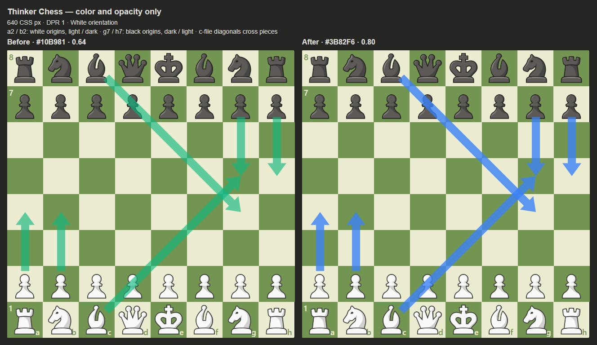
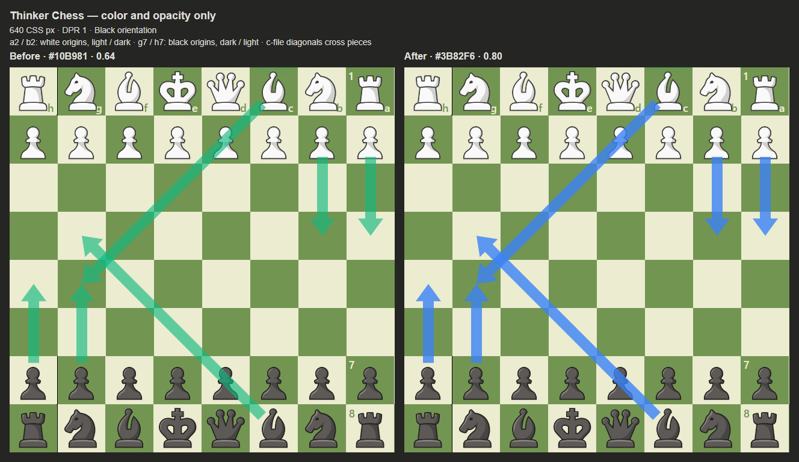
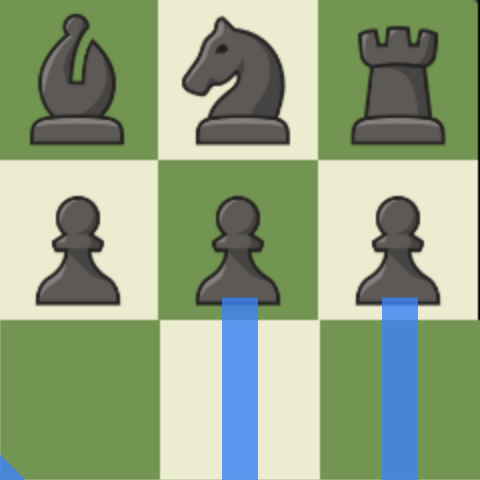

# Blue recommendation arrows — 2026-10-24

Production-only diff: six lines replaced in script.js. Fixed arrow color #3B82F6 and whole-path fill-opacity 0.8. Approved geometry, z-index 11, SVG viewBox, pointer-events, recommendation selection and all other behavior remain unchanged. The previous color study and its conclusions are untouched. The acceptance criterion for this change is hue distinction, not a 3:1 contrast pass.

## Exact production diff

```diff
-  const ARROW_COLOR = "#10B981";
+  const ARROW_COLOR = "#3B82F6";
@@ Theme fallback (preserve existing green Theme, independent of arrows)
-      ARROW_COLOR,
+      "#10B981",
@@ Arrow constants
-  const SHAFT_W = 0.225, HEAD_W = 0.525, HEAD_L = 0.36, TAIL_INSET = 0.36, OPACITY = 0.64;
+  const SHAFT_W = 0.225, HEAD_W = 0.525, HEAD_L = 0.36, TAIL_INSET = 0.36, OPACITY = 0.8;
@@ SVG path
-          <path d="${path}" fill="${current_color || ARROW_COLOR}" fill-opacity="${OPACITY}" />
+          <path d="${path}" fill="${ARROW_COLOR}" fill-opacity="${OPACITY}" />
@@ Both existing Theme update callbacks
-          $(".myarrow path").attr("fill", current_color);
+          $(".myarrow path").attr("fill", ARROW_COLOR);
```

The final replacement applies at two sites. Without it, existing saved green Theme settings or external configuration polling would repaint the approved blue arrow. Theme persistence/UI itself is unchanged. There is still exactly one production ARROW_COLOR declaration. No secondary/alternative recommendation renderer exists, so no new renderer or 0.5-opacity alternative was introduced.

## Before / after

Before is the production renderer from commit a96f8f1: green #10B981, opacity 0.64. After is the current production renderer: blue #3B82F6, opacity 0.8. Comparison fixtures temporarily compose six recommendations to show white/black origin pieces and both square colors at once; production still selects one recommendation.

- a2-a4: white pawn, light origin square.
- b2-b4: white pawn, dark origin square.
- g7-g5: black pawn, dark origin square.
- h7-h5: black pawn, light origin square.
- c1-g5 / c8-g4: diagonals crossing white/black pieces to inspect through-arrow visibility.







The blue remains recognizable by hue on both board colors. On dark green squares its luminance separation is more subdued than on light squares. #3B82F6 is retained exactly as approved. If a brighter treatment is desired after real-page review, #4C9AF5 is a proposed candidate only; it was not applied or represented as tested here.

White/black pawn silhouettes, body shading and outlines remain visually recognizable in the inspected normal/flipped screenshots, including diagonal crossings. This is visual inspection, not a universal recognition benchmark across all Chess.com themes. The single-path renderer uniformly preserves 20% of the underlying pixel contribution at full coverage; the existing tail inset also leaves most origin pieces uncovered.

## Matrix and checks

`node scripts/verify_blue_arrows.cjs` generates all 12 before/after screenshots: widths 400/640/900px × DPR 1/2 × normal/flipped. Filenames are `before-after-WIDTH-dprDPR-white/black.png`. The initial board is reconstructed from supplied reference tiles, and the flipped fixture reverses square positions without rotating piece artwork. These are local Chromium screenshots, not authenticated Chess.com.

Every case asserts identical before/after path coordinates, layer z-index and pointer-events; 72 before/after path pairs were checked. The path helper is additionally asserted byte-identical to a96f8f1. `verification.json` records every board rectangle and path/color/opacity.

`tests/test_recommendation_arrows.js` asserts unique blue constant, opacity 0.8, fixed-color path and no remaining Theme recolor to current_color, plus existing geometry cases. The Chromium regression passes all 12 board/DPR/orientation cases and actual pointer click/drag delivery. Its alpha samples across the head/shaft join and shaft are uniformly 204/255: no doubled-opacity joint. See `regression/browser-report.json` and `regression/tip-and-junction-300.png`.

Visual preference regression, all three deterministic build checks, userscript JavaScript syntax and git whitespace checks pass. Userscript size: 656720 bytes (informational). No console, Scout, banner, engine requests or mathematics changed.
