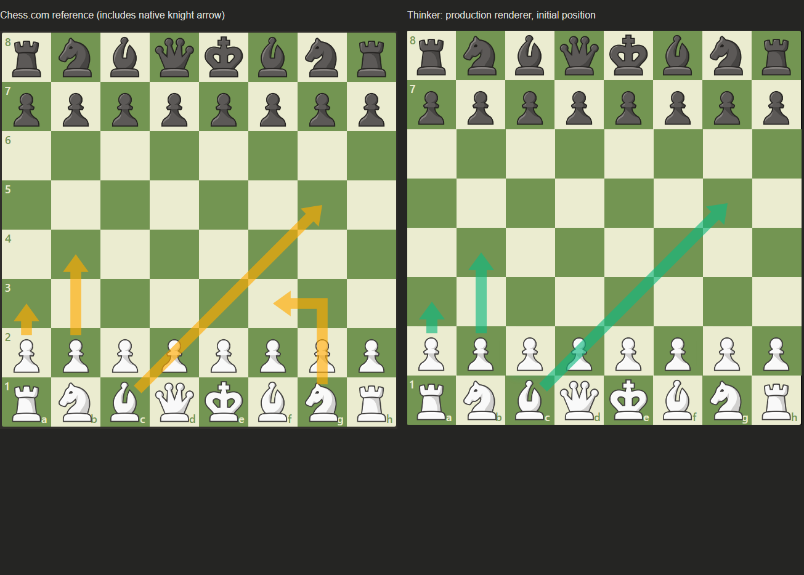

# Recommendation arrow rendering — 2026-10-24

## Investigation before editing

`script.js:create_div()` chooses `cached_board`, then `chess-board`, `wc-chess-board`, `.board`, `.chess-board`, `[class*='board-component']` or `wc-board`. It appends an absolutely positioned SVG covering the board, `.myarrow`, at z-index 11 with pointer-events none. The old 100-unit viewBox used 12.5-unit squares, center coordinates, `.flipped` or `orientation="black"`. The new 8-unit viewBox is mathematically equivalent and expresses geometry directly in squares.

The previous implementation removed only Thinker `.myarrow`/`.myhigh` nodes and displayed one recommendation. It had no knight-specific elbow: knight recommendations remain straight; no move-selection behavior was changed. The native reference's g1-f3 elbow is not newly implemented. The requested comparison reproduces a2-a3, b2-b4 and c1-g5. The fixture temporarily composes three independent production-renderer outputs for comparison; production still shows one.

Old line: stroke 1.6 viewBox units = 0.128 square; round caps and joins; stroke opacity 1. Marker: width/height 4, ref (2.6,2), default strokeWidth units, polygon `M0,0.5 L3,2 L0,3.5 L0.5,2 Z`. Its extent is 0.384 square long/wide, with a concave inset. Tip extends approximately 0.0512 square past the destination center. Tail has no inset and round cap extends 0.064 square behind the source. Color defaults to #10B981 with persisted theme override. SVG filter was `drop-shadow(0 4px 8px COLOR66)`.

`create_elm()` creates source/destination `div.highlight.square-N.myhigh`: opacity 0.85, 3px theme border, COLOR26 background, radius 25%, shadow `0 4px 12px COLOR33`, z-index 10. This function remains, guarded by `SHOW_SQUARE_HIGHLIGHTS=false`.

## Reference measurement

Input PNG: 645 × 647, board approximately (3,3)–(643,643), 80px square pitch. Color-mask measurements include antialias edges, with approximately ±1px raster uncertainty. `reference-measurements.json` contains the measured pixel runs. Grid pitch and crop bounds are manually identified reference coordinates; shaft/head lengths and alpha are extracted programmatically from the first vertical arrow.

| Property | Reference | Thinker | Difference |
|---|---:|---:|---:|
| Shaft width | 18px / 0.225s | 0.225s | 0 |
| Head width | 42px / 0.525s | 0.525s | 0 |
| Head length | 29px / 0.3625s | 0.360s | 0.0025s |
| Tail inset toward target | 29px / 0.3625s | 0.360s | 0.0025s |
| Tip | Destination center | Destination center | 0 |
| Effective opacity | 0.6389 dark / 0.6392 light | 0.64 | <0.0012 |

All geometry differences are below 0.02s. For 80px squares the new dimensions are 18px shaft, 42px head width, 28.8px head length/inset.

Native source orange rgb(255,170,0); dark square rgb(115,149,82), effective arrow rgb(204,163,29); light square rgb(235,236,208), effective arrow rgb(248,194,75). Least-squares alpha uses all RGB channels. Green is intentionally #10B981 rather than native orange; user-configured theme colors still work. OPACITY=0.64 is an evidence-based correction to the initial estimate, not a claim that native DOM CSS was inspected.

## Small production diff

`script.js`: 29 inserted / 22 removed lines, confined to arrow constants/default color, polygon helper, coordinate units, optional highlights and removing the two recolor callbacks' shadow/stroke updates. No console/banner markup or styles, engine request/score code, controllers or routes changed.

```diff
- <line stroke-width="1.6" stroke-linecap="round" marker-end="..." />
- <marker>...</marker>
+ <path d="...unified shaft and triangle..." fill-opacity="0.64" />
```

The SVG owns a separate Thinker layer, retains z-index 11 and pointer-events none, and does not remove or rewrite native arrow nodes. Ordinary pieces in the fixture are below the overlay; actual site stacking still requires a real-page smoke check. All coordinates derive from square centers and orientation; short paths clamp head length/width proportionally and never create a negative shaft length. Invalid/zero-length input renders nothing.

## Validation

- `python scripts/measure_arrow_reference.py` — reference measurements and reconstruction fixture.
- `node tests/test_recommendation_arrows.js` — horizontal, vertical, diagonal, 1/7-square, knight-vector, shortened, zero and invalid geometry; one filled path; no marker/line/shadow.
- `node tests/test_recommendation_arrows_chrome.js` — 12 combinations: board 400/640/900px × DPR 1/2 × white/black orientation. Measured polygon edges meet the reference tolerance in every combination. Black fixtures reverse square positions, not piece artwork orientation.
- Chromium pixels at y388/389/390 around the head/shaft junction and y420 in the shaft all have alpha 163/255 (rounding of 0.64): no doubled-opacity seam. See `browser-report.json`.
- Native-layer sentinel retained; zero highlight elements; pointer click and pressed-pointer drag delivered to the underlying piece fixture.
- `node tests/test_external_config_chrome.js` passed existing console/external configuration, responsive 390/800/1280px, synchronization, recovery and banner alignment regressions.
- `node tests/test_visual_preferences.js`, JavaScript syntax, all three deterministic build checks and git diff whitespace checks passed. Bundle: 656744 bytes, informational.
- Blind review found no production defect. Both evidence findings (unflipped background and hardcoded measured dimensions) were patched and the matrix rerun. No deferred findings.

## Screenshots and limits




The other `arrows-WIDTH-dprDPR-white/black.png` files show the complete matrix. Screenshots are local Chromium fixtures using production rendering functions extracted unchanged from script.js and initial-position tiles reconstructed from the supplied before image. They are not authenticated Chess.com screenshots. Antialiasing is normal browser vector rasterization; the 300% capture has no separate overlapping seam. No game was played and no engine integration changed.
