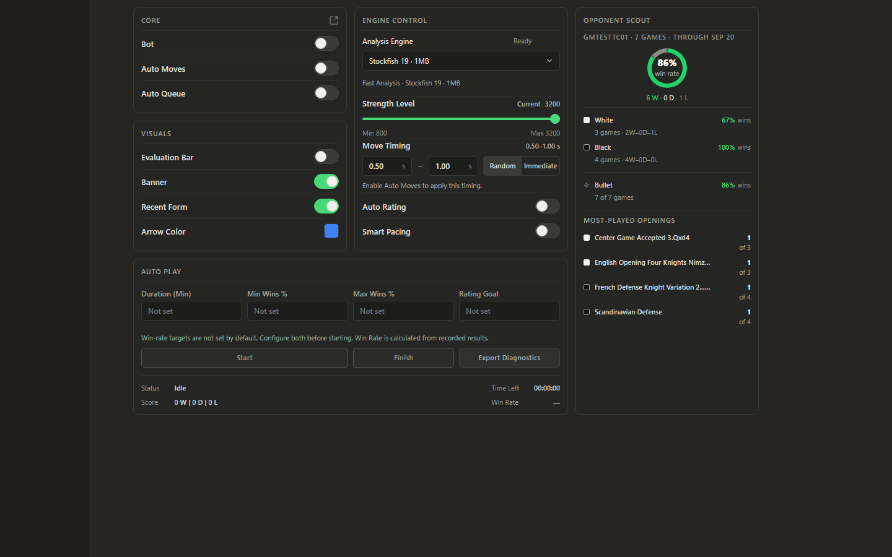
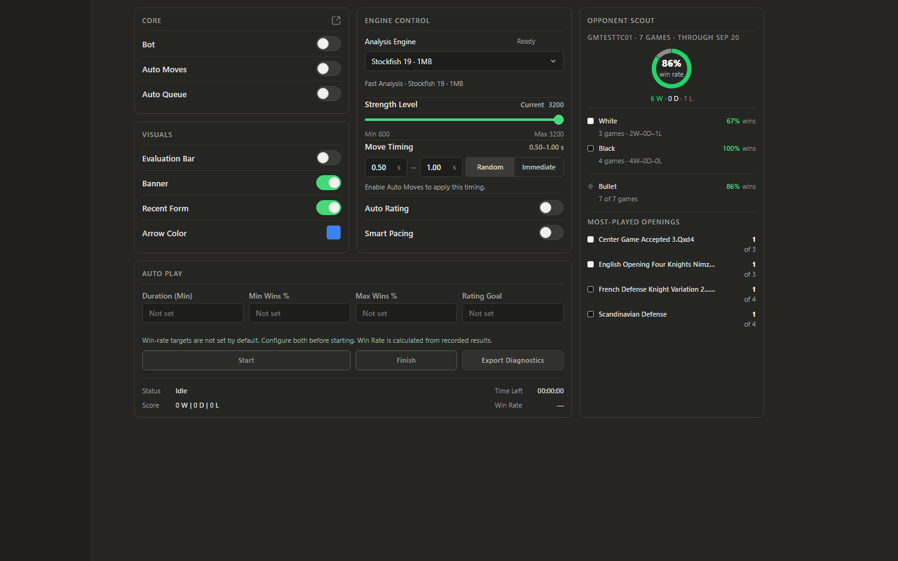
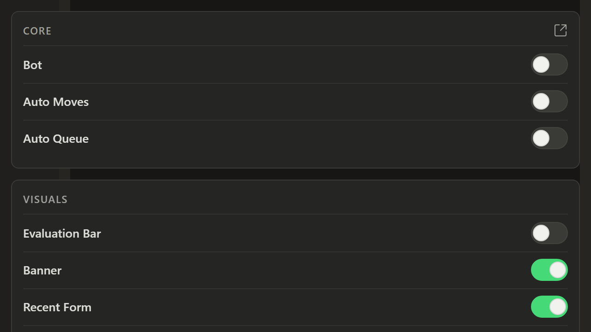
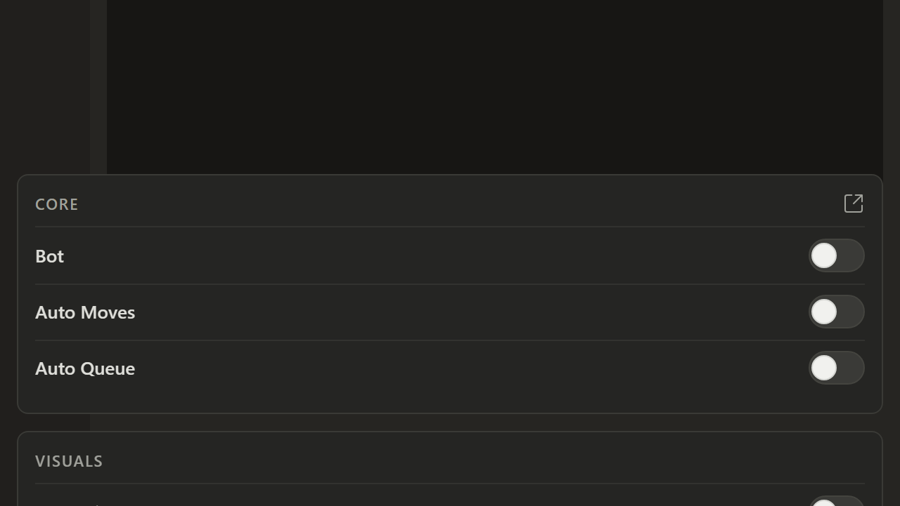
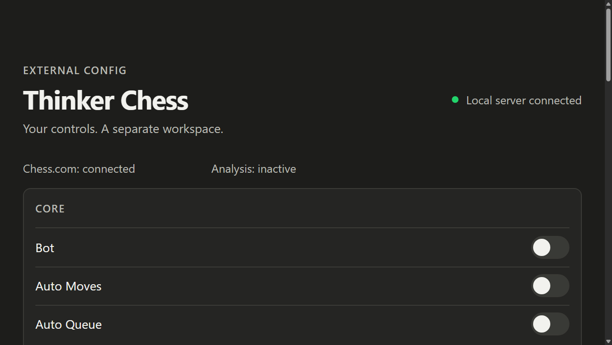
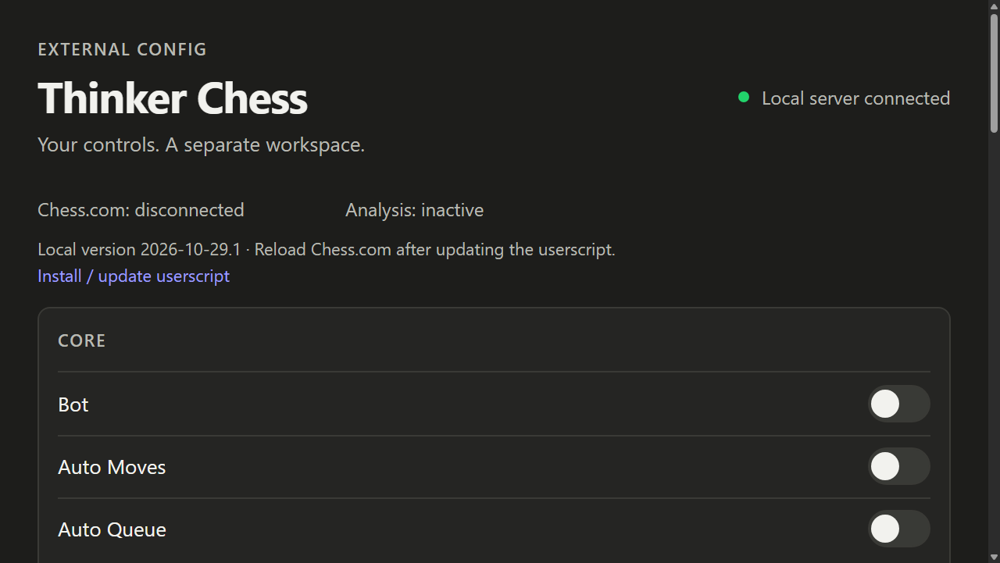
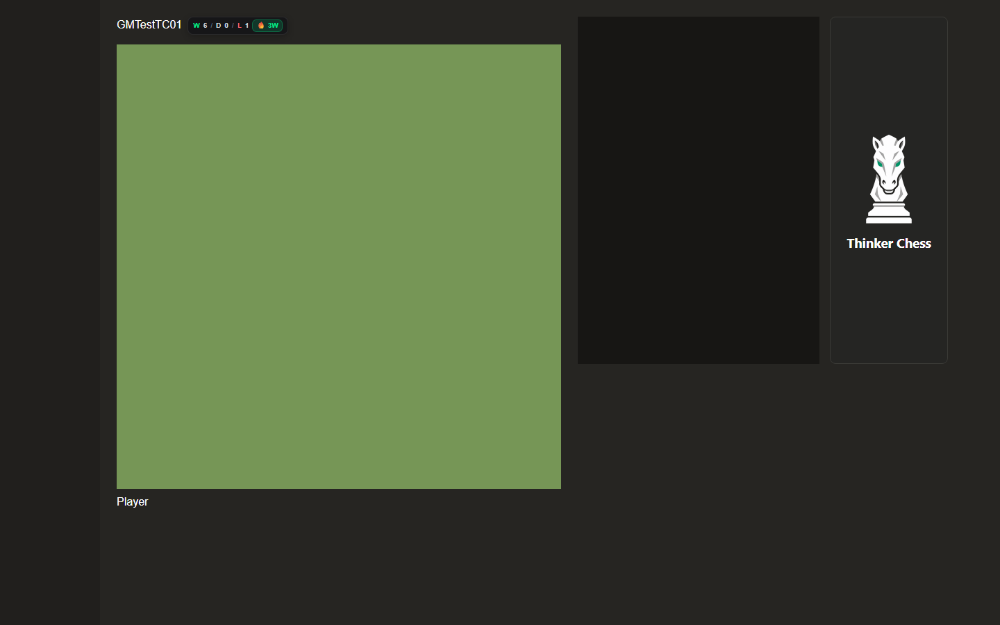
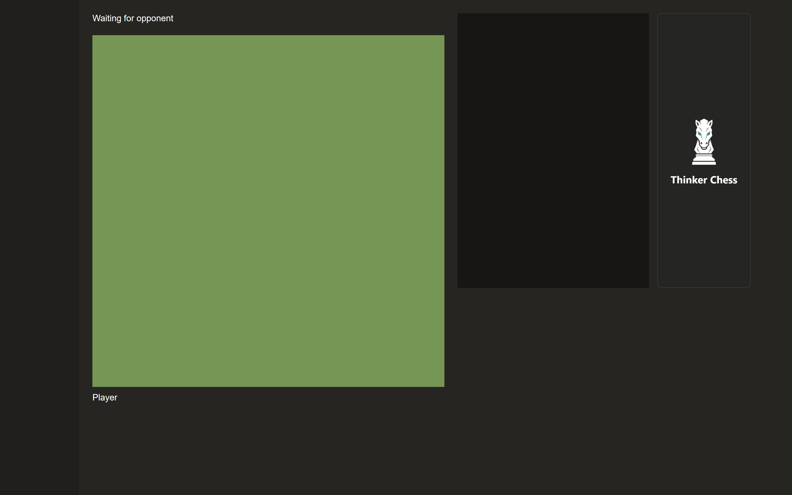
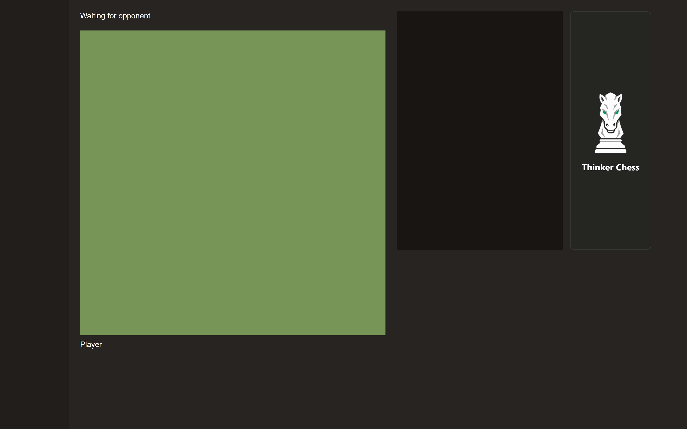

# Responsive display — implementação e evidências

Versão2026-10-29.1, Chrome156.0.8078.48 em Windows. Sem push.

A documentação completa de causas, inventário, arquivos e validação está em [RESPONSIVE_DISPLAY.md](../../../docs/RESPONSIVE_DISPLAY.md).

## Matriz executada

|Grupo|Resultado|
|---|---|
|Antes|281 cenários;4 ocorrências;0 exceções|
|Depois|361 cenários;0 violações;0 exceções|
|Zoom nativo|67/75/80/90/100/110/125/150/175/200%|
|Janelas de referência|1280×720,1366×768,1440×900,1920×1080,2560×1440|
|Janelas extras|780×520,980×640,640×480,640×240|
|Superfícies|External Config,console/host sintético,raiz,Analysis Lab Vite|
|Zoom dinâmico|12 mudanças sem reload;engine e nós preservados|
|Resize repetido|200 eventos por superfície:0 mutações nos painéis|
|Status|60s:0 mutações/recriações/CLS|
|Menu|11 larguras,teclado,persistência,geometria,cores|
|Setas|256 casos Flask+Komodo reais;ambas orientações;cor/opacity preservadas|
|Eval Bar|Visual,continuidade,polimento:aprovados|
|Session Control|14 suites aprovadas;Config backend3 testes|

Cada tamanho de janela é a referência da área de conteúdo a100%, em DIP. Em zoom diferente, o viewport CSS muda naturalmente: os valores efetivos estão em [matrix.csv](matrix.csv). Não são emulações de DPR nem uma alegação sobre resoluções físicas de monitor.

Critérios automáticos:overflow horizontal de página/painéis,campos numéricos,cantos do menu e diálogo,estado/persistência e deriva após resize. Rolagem vertical de painéis longos é intencional. Nenhum cenário físico/auth não executado é tratado como aprovado.

## Causas e resultados

- Mesmo wrapper1034px recebia regras diferentes a1086px. Agora as decisões dependem do espaço do painel,com grade desktop canônica.
- Auto Play com quatro colunas e posições fixas de botões ultrapassava a largura disponível. Query do painel reorganiza campos,ações e status.
- Atualização de posição da sidebar não era garantida após mudanças de layout. Candidatos ocultos e ancestrais são observados; reads/writes passam por RAF.
- Body posicionado deslocava console30px:medição passou de233 para203px,valor esperado.
- DPR efetivo3 reduzia arte46px CSS. Agora são70px CSS,com mesmo card e bitmap.
- Menu com altura fixa/innerHeight não refletia todo o espaço visual. Limites e rolagem são calculados pelos dois eixos.
- Timer de reconciliação e load callback tinham cleanup incompleto. Teste de teardown idempotente passou.

As dimensões dos painéis Config/Core/Visuals/Engine/Auto Play e do card da raiz a1440/100% foram preservadas. No console,os painéis continuam345/345/345px e Auto Play702px,com alturas171/211/394/252px. A mudança intencional é retirar a exceção1086 que reduzia Scout a282px; ele fica296px como nos demais desktops.

## Antes/depois

### Console populado1440

### Console estreito,zoom200%

### External Config,zoom200%

### Banner1440

### Arte em DPR3,zoom nativo200% + escala simulada150%

## Auditoria e limitações

Scout/Recent Form foram populados com50 partidas sintéticas/4 aberturas usando o renderizador real. As larguras efetivamente medidas nessa cena são1086/1440/780/500px;Chrome limitou a janela solicitada320px a500px. A matriz nativa separada alcança320px CSS por zoom200%,sem confundir os cenários.

Toast usa apenas sua apresentação de aviso existente no teste,sem iniciar gameplay/sessão. Color picker e tooltips nativos são controlados pelo navegador/OS. O modo minimizado legado não ganhou uma nova ação de minimizar.

Não foram encontradas posições de painel arrastáveis/persistidas;não houve reset de preferências. Não se alteraram endpoints,intervalos operacionais,autenticação,licenciamento,engine runtime ou autorização.

A fonte de medição do Lab foi corrigida para incluir as classes reais de Engine/Moves/Settings;no antes,a verificação desses painéis era pelo overflow da página. O depois contém suas medidas individuais.

A regressão antiga da Eval Bar tinha um relógio sintético que atravessava a janela100ms e esperava100 eventos coalescidos. Só a fixture passou a gerar a rajada em50ms;asserções e produção mantidas.

Hardware multi-monitor e sessão autenticada do Chess.com/Tampermonkey não foram exercitados. Escala150% foi simulada em perfil temporário. Bitmap140×280 pode ser interpolado acima de DPR2;nenhuma resolução extra foi inventada.

Dados brutos:before/report.json,after/report.json,dynamic-zoom/report.json,density-simulation/report.json,density-artwork/report.json,scenes/report.json e regression/. Medidas de painéis:[panels.csv](panels.csv). Diff de produção:[production.diff](production.diff).

