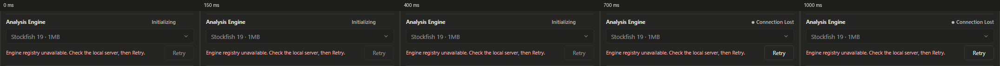
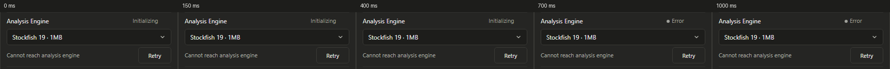
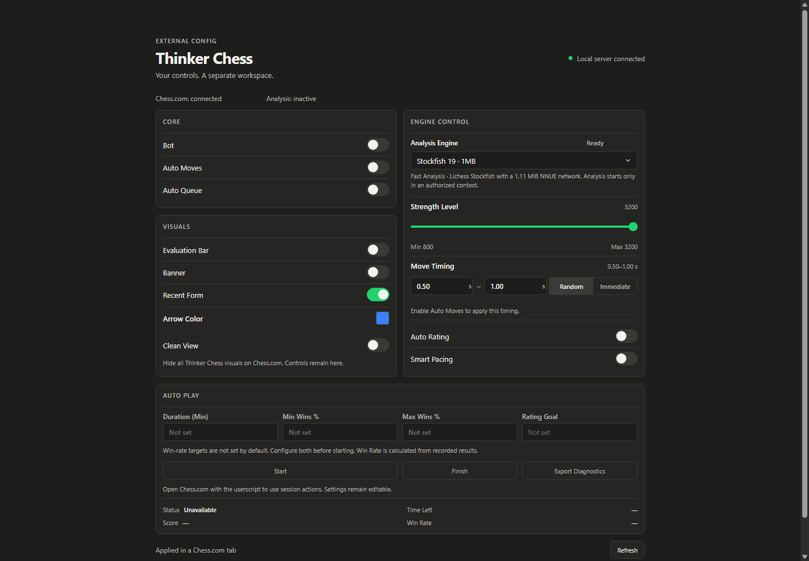
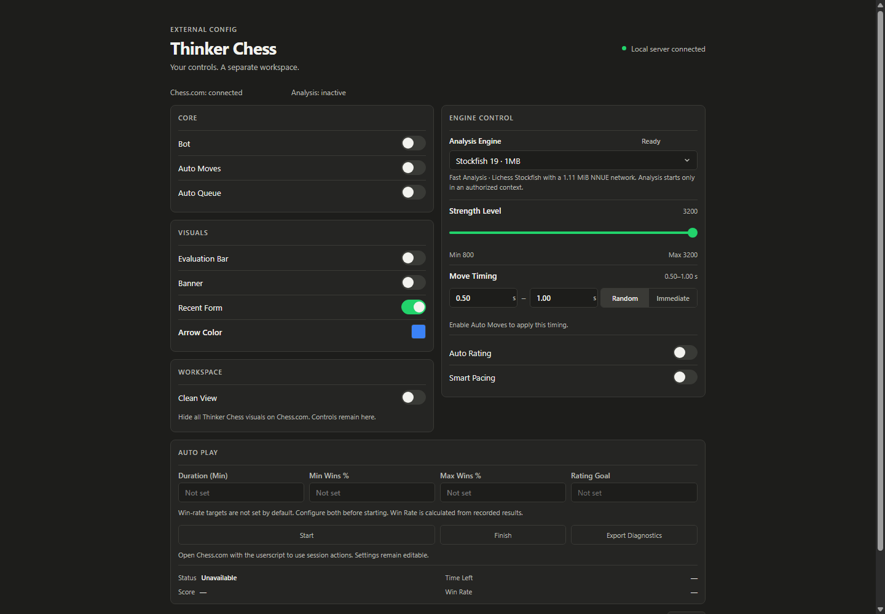

# Retry, Banner and header — verification

Release2026-10-27.1. Three isolated commits, no push. Unrelated working-tree files were preserved.

## Retry evidence

|Surface|Scenario|Initializing duration(ms)|Final|Total engine requests|
|---|---|---:|---|---:|
|config|offline|708.6|Connection Lost|1|
|config|reduced|706.5|Connection Lost|1|
|config|online|712.2|Ready|1|
|config|switch|707.8|Ready|2|
|config|slow-switch|1036.7|Ready|1|
|config|failed-switch|715.9|Connection Lost|2|
|console|offline|703.3|Error|1|
|console|reduced|706.2|Error|1|
|console|online|705.4|Ready|1|
|console|switch|701.9|Ready|1|
|console|slow-switch|1054.6|Ready|1|
|console|failed-switch|708.3|Error|1|

Baseline refusal: Config4.0ms, Console2.2ms; original code clears interactive in finally immediately. Original successful Retry: Config8.0ms and console10.5ms, measured by serving commitcbee05a source in the isolated browser (baseline-timing/report.json). Minimum700ms from action start, final opacity-only fade180ms. No optional pulsing dot. Reduced-motion: same minimum, no fade. Error static once fade ends; getAnimations()0. Slow1000ms transport yields1037–1055ms total, not1700ms. Repeated Retry clicks issue one request, no queue. Config selection has its pre-existing follow-up registry GET; the single preference POST remains one. Focus restores to Retry on failure or picker on success; moving focus elsewhere is preserved. Final-only polite region announces once. No new visible copy: console keeps Error, Config keeps Connection Lost.

Existing60s regression passed: zero mutations, node recreation and CLS on both surfaces after initial rendering. Automatic polls have no700ms hold or fades. Health/backoff, operational relay, authorization and recommendation logic unchanged.

## Banner

Only Config small#banner-display-state and its row aria-describedby were removed. Source previously mapped Disabled/Visible on Chess.com/Hidden by Clean View and board/layout states. Server bannerState remains, native role=switch, aria-checked and Banner name remain. Console already lacked a subtitle. Tests previously depending on hint text now assert its absence and real switch state.

All10 cases: each control row40px, text/toggle center delta0px, upper/lower toggle clearance8/8px. Visuals239→215px(−24), Core175, Workspace119, Engine476. Details in rows.csv and panels.csv.

Column policy cannot close the remaining57px:175+215+119+24gaps=533 vs476. Existing81px gap reduced by24. Maximum three8px junctions absorbs24, leaving33; row height already40. No stretch or blank-tail compensation applied.

Proposed ONLY: move Clean View into Visuals, remove Workspace shell; natural column466px vs Engine476. Add8+2px between sections to reach476, rows40 unchanged. The preview is not production.

## Header states and positions

|Width|State|Eyebrow y|Panel y|Guidance height|Final gap|
|---:|---|---:|---:|---:|---:|
|1440|current|65|196|0|12|
|1440|outdated|23|196|34|12|
|1440|absent|23|196|34|12|
|1280|current|65|196|0|12|
|1280|outdated|23|196|34|12|
|1280|absent|23|196|34|12|
|1024|current|65|196|0|12|
|1024|outdated|23|196|34|12|
|1024|absent|23|196|34|12|
|768|current|65|196|0|12|
|768|outdated|23|196|34|12|
|768|absent|23|196|34|12|
|390|current|49|208|0|12|
|390|outdated|7|225|51|12|
|390|absent|7|225|51|12|

Current-version row including link is hidden, with no reserved empty row. Its25px(17+8) is transferred to top padding:40→65px desktop,24→49px narrow. Panel y remains196/208 as baseline, final header gap12px. Local connection keeps original relationship to title. Header content itself moves down25px.

Existing non-current copy remains exactly:

- Unknown server release: “Restart the local server to verify the installed userscript.”
- Absent/disconnected heartbeat: “Local version … · Reload Chess.com after updating the userscript.”
- Mismatch/missing browser version: “Userscript update required · local version …, browser …/not verified.”
- Current connected: no visible row.

Link text remains Update userscript now when outdated, otherwise Install / update userscript; href unchanged /thinker-chess.user.js. No orphan separator, link left equals header left. True first-load server absence retains existing Checking installed userscript…/Update userscript until metadata is known; no new copy added.

Non-current guidance now occupies34px desktop and51px at390. Top inset compensates desktop so panels stay196. At390 guidance preserves full copy and panels shift17px to225; headline inset7px. This is reported rather than clipping text or inventing a placeholder. For a strict zero shift at390 an additional header layout/copy tradeoff needs approval.

## Decisions left to the user

1. Keep install link available even when current? Not applied; entire current row/link is hidden as requested.
2. Top margin:65px vs left277/197/69/24px at1440/1280/1024/768; narrow49px vs12px. Alternative screenshot moves header and panels up25px together; not applied.
3. At390 absent/outdated guidance adds17px to panel y and moves the header upward. Decide whether to approve a different arrangement/copy to remove that shift. No further adjustment applied.
4. Approve Clean View rebalance preview to eliminate remaining57px Config column mismatch? Not applied.

## Scope and regression

Console12 cases:1086/1280/1440/1920/1033/800 with Banner on/off, all panel/title rectangles and component colors byte-equal to baseline JSON. Config10 cases:1440/1280/1024/768/390 with Banner on/off, component colors unchanged; current panel top unchanged. Existing console alignments/gaps preserved. Config columns remain the reported pre-existing residual mismatch; no false claim of alignment. No new fractional control/panel rectangles introduced; pre-existing text bounds/header half-pixel alignment retained. No horizontal overflow in Config390. Existing component tokens/colors/fonts untouched.

Real Flask registry/preference routes and full generated userscript were exercised in isolated Chromium, with controlled network faults; no gameplay manipulation. Live5050 Config200, healthok/readytrue. No authentication/Tampermonkey installation was accessed or altered. No claim of testing inside the authenticated Chess.com tab. Browser-native network refusal diagnostics remain outside JS control; no console masking added.

Deterministic checks passed: build_analysis_engine.py --check, build_userscript.py --check, build-rating-tracker.mjs --check, node --check script.js, test_status_runtime.js, test_analysis_engine_selection.js. Browser tests: retry_header, retry_interaction(including failed keyboard selection), header_states, existing status_all_indicators60s.

Review: independent blind/edge reviewers found focus restoration on failed selection and focus-stealing if the user tabs elsewhere. Both fixed by tracking original picker focus and preserving subsequent focus choices.

Screenshots: before/, after/, banner/, header-states/. Per-item diffs in diffs/. Baseline online/offline full-page screenshots at1440/1024/390 are in baseline-timing/.
