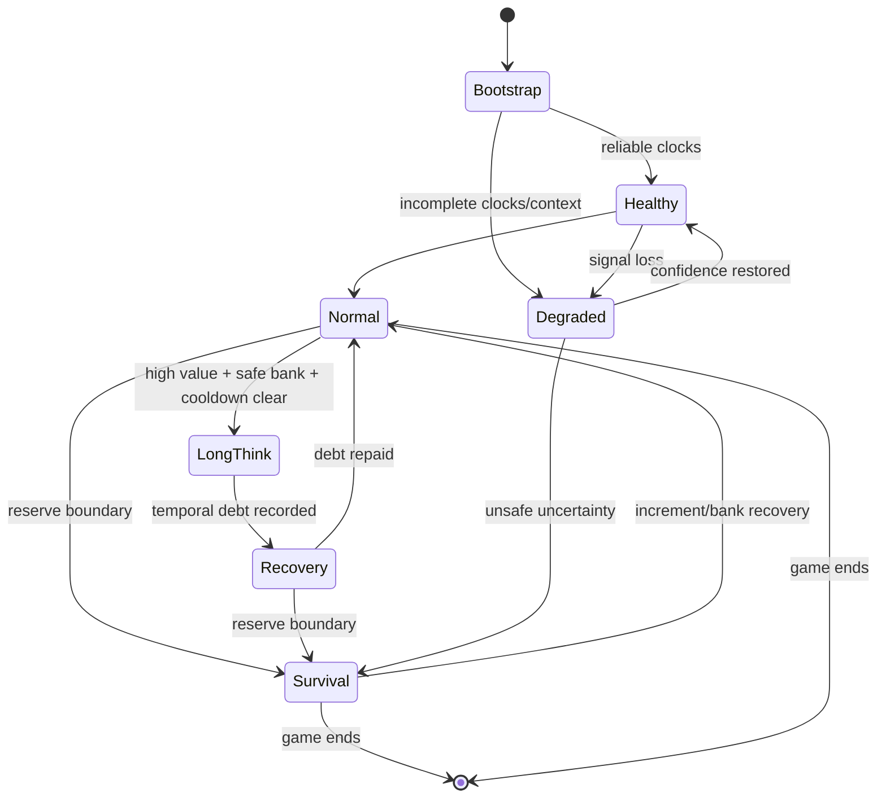

# Architecture Spine — Smart Pacing

## Design Paradigm

**Functional Core, Imperative Shell with Ports and Adapters.** Pure reducers and policies transform typed snapshots into an explainable `PacingDecision`. Browser DOM, clocks, HTTP, Komodo, storage, telemetry, timers, and move execution remain adapters around that core.

```mermaid
flowchart LR
    PA[Platform adapter] --> CC[Clock context]
    PA --> MP[/move-plan client]
    MP --> MS[MovePlanService]
    MS --> EC[Engine coordinator]
    EC --> EA[Engine analyzer]
    EA --> CE[Complexity evidence]
    CC --> PC[Pacing core]
    CE --> PC
    PS[Pacing session] <--> PC
    PC --> PD[PacingDecision]
    PD --> SE[Single scheduler/executor]
    PD -. optional .-> TP[Telemetry port]
    SP[Settings port] --> PC
```

## Invariants & Rules

### AD-1 — Pure pacing decision core [ADOPTED]

- **Binds:** time-budget, human-timing, pacing-session
- **Prevents:** DOM state, timers, storage, network timing, and random globals from producing unrepeatable policy behavior.
- **Rule:** The core accepts immutable typed inputs plus an injected random source and returns a decision plus the next session state without performing I/O.

### AD-2 — One transaction, two declared engine lenses [ADOPTED]

- **Binds:** move-plan, complexity-evidence
- **Prevents:** duplicated engine work and disagreement between separately selected moves and separately classified positions.
- **Rule:** Smart Pacing obtains one atomic `/move-plan` executed in this order on the single engine: reference-shallow MultiPV; bounded Elo selector; reference-deep over the union of shallow top-k and the selected move. The response binds both configs, selected move, reference best, selected-move regret, identity, deadline, and engine generation. If the selector cannot start, fails, expires, is cancelled, or returns an illegal/invalid move, it performs no out-of-budget retry and falls back to the legal shallow reference best with stable `SELECTOR_FALLBACK_{NOT_STARTED|FAILED|EXPIRED|CANCELLED|INVALID}` reason code. If deep refinement cannot finish, evidence is typed partial. Legacy `/getmove` and `/analyze` never participate in the new path.

### AD-3 — Split ownership at the engine/clock boundary [ADOPTED]

- **Binds:** move-plan, time-budget
- **Prevents:** the backend guessing live browser clocks or the browser reimplementing chess analysis.
- **Rule:** The backend owns move selection and chess-derived evidence; the browser owns live clock/session context, temporal allocation, and the execution instant.

### AD-4 — Stateful safe time bank [ADOPTED]

- **Binds:** time-budget, pacing-session
- **Prevents:** independent per-move delays from chaining unsafe long thinks or ignoring prior overspend.
- **Rule:** Every clocked game has an in-memory session reducer with immutable clock observations, survival reserve, a conservative interval for moves remaining, inferred increment confidence, opponent-turn opportunity, temporal debt, long-think eligibility/cooldown, and recovery; no universal delay ceiling is permitted.

### AD-5 — Explainable continuous complexity [ADOPTED]

- **Binds:** complexity-evidence
- **Prevents:** a discrete best-versus-second-best score gap from masquerading as human decision difficulty.
- **Rule:** A staged MultiPV reference analysis returns separate bounded `decisionValue`, `forcedness`, `analysisConfidence`, and `moveProvenanceConfidence` values plus raw signals and reason codes. Analysis coverage and move provenance are never overloaded into one confidence field. `moveSelectionElo` governs the played move, `perceptionElo` governs interpretation of reference evidence, and universal clock safety is independent of both.

### AD-6 — Extra computation must earn extra time [ADOPTED]

- **Binds:** complexity-evidence, human-timing
- **Prevents:** legal-move count, tactical appearance, or random jitter alone from causing long thinks.
- **Rule:** Long-think eligibility requires sufficient decision value measured by shallow-to-deep instability/regret, sufficient confidence and safe clock budget, low forcedness, no active cooldown, and contextual preparation computed from the prior forecast plus actual opponent-turn duration. Static signals or randomness alone cannot create a long think.

### AD-7 — Typed clocks and monotonic elapsed time [ADOPTED]

- **Binds:** clock-context, time-budget, move-scheduling
- **Prevents:** seconds/milliseconds confusion, system-clock jumps, opponent-clock inversion, and hidden fallback to fixed timing.
- **Rule:** Internal duration values are integer milliseconds, each immutable clock observation carries identity and confidence, elapsed decision time uses a monotonic clock, and invalid/missing signals degrade independently. Only the session reducer owns inference windows and estimates.

### AD-8 — One scheduler with final execution guards [ADOPTED]

- **Binds:** move-scheduling
- **Prevents:** duplicate timers, stale moves, and execution after navigation, position change, game replacement, or automation disablement.
- **Rule:** `auto_move_piece` or its direct successor remains the sole scheduler/executor, with at most one pending timer and one active plan per runtime session. Replacement atomically cancels the prior revision. Execution revalidates exact observation key, game identity, full UCI move including promotion, enabled state, legality, and cancellation; only an idempotent outcome matching the current revision may commit the reducer, and duplicates/out-of-order outcomes are ignored. MAX remains synchronous.

### AD-9 — Technical latency is explicit [ADOPTED]

- **Binds:** move-plan, human-timing, pacing-telemetry
- **Prevents:** cold start, engine recovery, timeout, cache, or network latency from being mislabeled as human deliberation.
- **Rule:** The browser computes a versioned preflight analysis budget before requesting a plan. Before any engine lock, the server registry rejects/coalesces stale revisions and converts the relative budget to an absolute monotonic deadline. Every queue/stage/retry checks remaining time; cooperative stop gets at most `cancellationGraceMs=250`, after which the engine process is force-restarted and its generation invalidated. A successor never waits on obsolete work beyond that grace plus restart admission; otherwise it receives typed fallback. HTTP abort alone is not cancellation. The trace separates observation, request, queue, stages, response, schedule, and execution.

### AD-10 — Correctness requires no durable history [ADOPTED]

- **Binds:** pacing-session, settings, pacing-telemetry
- **Prevents:** browser cleanup, restart, reinstall, offline use, or unavailable cloud services from breaking pacing.
- **Rule:** Per-game pacing state is ephemeral and reconstructible from the live position and clocks; state loss triggers conservative bootstrap. Durable settings and optional telemetry are accessed only through versioned ports.

### AD-11 — Local-first, cloud-ready persistence [ADOPTED]

- **Binds:** settings, pacing-telemetry
- **Prevents:** direct `localStorage`, localhost files, or a future cloud provider from becoming a hidden dependency of the policy core.
- **Rule:** `PacingSettingsPort` and `PacingTelemetryPort` have replaceable local and future cloud adapters; telemetry is bounded, erasable, exportable, optional, and excludes identity and raw game records by default.

### AD-12 — Version every behavioral boundary

- **Binds:** move-plan, complexity-evidence, time-budget, pacing-telemetry, cache
- **Prevents:** stale cache entries, old telemetry, frontend/backend drift, and silent behavior changes after tuning.
- **Rule:** API schemas, evidence model, timing model, cache key, and telemetry event carry explicit versions; incompatible versions fail closed to a documented conservative policy.

### AD-13 — Calibrate distributions, do not tune anecdotes

- **Binds:** human-timing, pacing-telemetry, tests
- **Prevents:** fixing one observed position while regressing complete games or time controls.
- **Rule:** Parameter changes require golden-position, property, distribution, full-game simulation, and shadow/replay evidence across Bullet, Blitz, Rapid, increment, Elo, degraded, and restart scenarios.

### AD-14 — Platform integration is an adapter

- **Binds:** platform-adapter, clock-context, move-scheduling
- **Prevents:** platform-specific DOM and integration assumptions from contaminating the reusable pacing engine or blocking commercialization.
- **Rule:** Platform discovery and execution live behind a replaceable adapter; the pacing core has no platform imports.

### AD-15 — Three position identities, never one overloaded key [ADOPTED]

- **Binds:** move-plan, cache, cancellation, move-scheduling
- **Prevents:** stale execution, invalid repetition claims, cache poisoning by context, and accidental equality between two game observations.
- **Rule:** `observationKey = hash(schemaVersion, runtimeGameToken, positionRevision, exactFullFen)` is runtime-only. `analysisPositionKey = hash(keyVersion, boardFen, sideToMove, castlingRights, enPassantSquare, halfmoveClock, historyDigestOrUnknown)` identifies analysis. Pure-reference cache adds `(analysisTier, engineGeneration, referenceAnalyzerVersion, evidenceModelVersion)`; selection cache adds `(quantizedMoveSelectionElo, moveSelectorVersion, selectorSeedPolicyVersion)`. A cached complete backend plan uses `contextualPlanKey = hash(planKeyVersion, analysisPositionKey, normalizedLastMoveOrNone, historyDigestOrUnknown, analysisTier, analysisBudgetClass, engineGeneration, bookVersion, referenceAnalyzerVersion, evidenceModelVersion, quantizedMoveSelectionElo, moveSelectorVersion, selectorSeedPolicyVersion, quantizedPerceptionElo, perceptionModelVersion)`. Partial, fallback, cancelled, obsolete, or recovering results are never cached. Clock, preparation, debt, and personality remain uncached frontend overlays. FEN alone never claims complete repetition history.

### AD-16 — The local API is a security boundary [ADOPTED]

- **Binds:** move-plan, commercialization
- **Prevents:** arbitrary websites driving the local engine, unbounded requests, and future cloud assumptions leaking into localhost.
- **Rule:** The service binds loopback only. Install generates a 256-bit secret in an OS-user-readable config; explicit one-time pairing copies/exchanges it into isolated userscript storage, never page storage or an unauthenticated endpoint. All engine routes, including legacy and `/eval`, require bearer capability, schema/payload/rate/concurrency limits and origin checks when the client supplies Origin; legacy routes are disabled by default after cutover. No request accepts arbitrary UCI options. Cloud auth is separate.

### AD-17 — Calibration is a versioned release artifact [ADOPTED]

- **Binds:** human-timing, pacing-telemetry, tests
- **Prevents:** subjective tuning, unmeasured regressions, and parameters promoted from sparse examples.
- **Rule:** Every promoted parameter set has a generated, versioned scorecard covering conditional quantile error, long-think rate/inter-arrival/clustering, within-session correlation, opponent-turn preparation delta, cap hits, target-versus-actual, flags/reserve/debt recovery, held-out regressions, corpus coverage, sample counts, and confidence intervals.

### AD-18 — Puzzle is not a competitive pacing session [ADOPTED]

- **Binds:** time-budget, pacing-session, telemetry
- **Prevents:** puzzle behavior contaminating competitive debt, clock inference, calibration, or state.
- **Rule:** Puzzle uses a separate stateless presentation policy and namespace. It never updates the competitive reducer, increment inference, debt, preparation, or competitive telemetry.

### AD-19 — One coordinator owns every engine job [ADOPTED]

- **Binds:** move-plan, eval, legacy-engine-routes, cancellation
- **Prevents:** `/eval`, legacy endpoints, warmup, or background work from interleaving a plan, bypassing deadlines, or retaining the global lock.
- **Rule:** An `EngineCoordinator` admits work before lock acquisition, prioritizes current move plans, makes eval/background jobs preemptible or rejectable while a plan is active, and is the only caller of the Komodo adapter. No route decorator may acquire the engine lock ahead of revision/deadline admission.

### AD-20 — Safety and release envelopes are immutable inputs [ADOPTED]

- **Binds:** time-budget, rollout, operations
- **Prevents:** reserve overspend, moving rollout goalposts, unowned SLOs, and incompatible client/server deployment.
- **Rule:** For every voluntary decision, `targetTotalMs <= max(0, userRemainingAtObservationMs - reserveMs - executionMarginMs)` and preflight budgets must satisfy the same bound. Each shadow/release run uses an immutable manifest containing corpus hash, parameter/schema compatibility ranges, thresholds, sample minima, SLO owner/approver, rollback triggers, and artifact versions. `/health` reports process/engine readiness and generation; incompatible versions fail closed, and restart enters degraded mode until ready.

## Consistency Conventions

| Concern | Convention |
| --- | --- |
| Durations | Integer milliseconds with `Ms` suffix; percentages and normalized scores are finite numbers in `[0,1]`. |
| Position identity | Exact `observationKey` for runtime safety; canonical `analysisPositionKey` plus qualified history for chess analysis; separate versioned cache keys for pure analysis and any move-affecting context. |
| Contracts | `camelCase` JSON with `schemaVersion`, `requestId`, `observationKey`, `analysisPositionKey`, `positionRevision`, `source`, `evidence`, and `diagnostics`. |
| Reasons | Stable machine-readable reason codes; prose exists only in diagnostics/UI mapping. |
| Confidence | Missing inputs reduce confidence per signal; they never silently assign neutral complexity. |
| Randomness | Injected, seedable, bounded, and applied after rational allocation; a seed reproduces a complete simulated game. |
| Mutation | Only the pacing-session reducer mutates logical session state; only the scheduler owns pending execution state. |
| Telemetry | Default events are bounded aggregates without identity, raw FEN, or PGN. Exact replay is an explicit local diagnostic mode with consent and retention controls. |
| Errors | Validation is explicit; engine partial/timeout/unavailable results are typed outcomes, not generic success responses. |

## Stack

| Name | Version |
| --- | --- |
| Python | 3.12.7 |
| Flask | 3.1.3 |
| Flask-SocketIO | 5.6.1 |
| flask-cors | 6.0.2 |
| chess package | 1.11.2 |
| psutil | 7.2.2 |
| Komodo | 14.1 |
| Node.js test runtime | 22.23.2 |
| Tampermonkey userscript manifest | TC157 `2026-10-08.4` |

## Structural Seed

```text
core/
  smart_pacing/
    contracts.py       # versioned move-plan DTO validation
    service.py         # one ordered two-lens turn-plan transaction
    coordinator.py     # admission, priority, cancellation and engine ownership
    analyzer.py        # staged Komodo analysis
    evidence.py        # pure signal normalization and scores
    cache.py           # pure-analysis cache plus contextual plan keys
src/
  smart_pacing/
    contracts.js       # frontend DTO validation
    platform-adapter.js # position/clock observation and exact move execution
    clock-context.js   # immutable clock observations only
    preflight.js       # analysis budget before network/engine work
    session.js         # pure reducer; increment/moves-left inference and commit order
    budget.js          # reserve, sustainable spend, debt, burst caps
    humanizer.js       # conditional, seedable timing distribution
    decision.js        # pure evidence + budget -> decision
    ports.js           # settings and telemetry interfaces
tests/
  fixtures/smart_pacing_positions.json
  test_move_plan.py
  test_smart_pacer.js
  test_smart_pacer_sequences.js
scripts/
  calibrate_smart_pacing.py
  replay_smart_pacing.py
```



## Capability → Architecture Map

| Capability / Area | Lives in | Governed by |
| --- | --- | --- |
| Unified move and analysis | `core/smart_pacing/service.py` | AD-2, AD-3, AD-9, AD-12 |
| Human-relative complexity | `analyzer.py`, `evidence.py` | AD-5, AD-6, AD-13 |
| Clock observation | `clock-context.js`, platform adapter | AD-3, AD-7, AD-14 |
| Increment and moves-left inference | `session.js` | AD-4, AD-7, AD-10 |
| Stateful time allocation | `session.js`, `budget.js` | AD-1, AD-4, AD-6 |
| Human timing distribution | `humanizer.js`, `decision.js` | AD-1, AD-6, AD-13 |
| Safe delayed execution | current `auto_move_piece` integration | AD-7, AD-8, AD-9, AD-15 |
| Local/cloud persistence seam | `ports.js` plus adapters | AD-10, AD-11, AD-12 |
| Calibration and regression proof | fixtures, scripts, sequence tests | AD-12, AD-13 |
| Platform commercialization seam | platform adapter | AD-14 |
| Local API trust boundary | Flask entrypoint and request registry | AD-9, AD-12, AD-16 |
| Quantitative release report | calibration script and held-out corpus | AD-13, AD-17 |
| Separate puzzle behavior | puzzle presentation policy | AD-18 |
| Global engine admission | `coordinator.py` | AD-2, AD-9, AD-19 |
| Operational/release envelope | health endpoint and release manifest | AD-13, AD-17, AD-20 |

## Deferred

- **Exact numerical weights and quantiles:** finalize from replay, shadow, and full-game calibration; fixing them in architecture would make anecdotes permanent.
- **Userscript bundler and packaging tool:** choose during implementation bootstrap; the invariant is source modules plus one reproducible generated artifact.
- **Cloud provider, authentication, billing, entitlement, sync conflicts, and account recovery:** separate commercial-platform architecture; no Smart Pacing correctness path may wait on it.
- **Learned/ML timing policy:** consider only after the explainable model has sufficient consented/licensed calibration data and remains a compatible implementation of the same contracts.
- **Platform-specific selectors and metadata probes:** owned by each platform adapter and verified through fixtures; never elevated into pacing rules.
- **Exact data-retention policy for optional cloud telemetry:** decide with product jurisdiction, consent model, and privacy counsel before collection.
