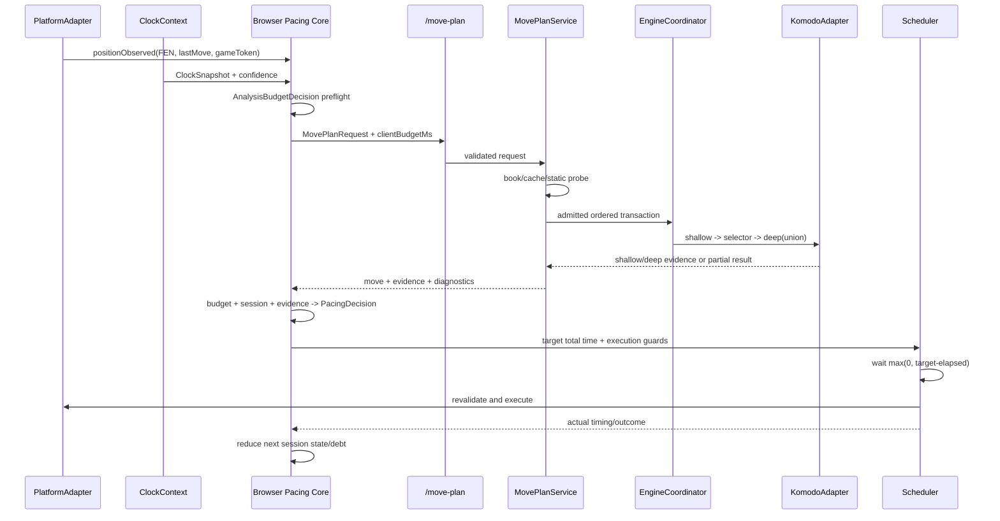

# Solution Design — Smart Pacing definitivo

**Data:** 2026-10-10  
**Estado:** arquitetura final pronta para implementação faseada  
**Público:** proprietário do Thinker Chess e agente/desenvolvedor responsável pela implementação  
**Companion:** `ARCHITECTURE-SPINE.md`

## 1. Resultado pretendido

O Smart Pacing deve gerir o relógio como um jogador humano forte: responder quase por reflexo a lances conhecidos ou forçados, gastar tempo sustentável em decisões normais e reservar pensamentos longos para posições em que cálculo adicional realmente pode alterar a decisão. O comportamento precisa permanecer coerente durante uma partida completa, não apenas parecer correto em testes isolados.

O sistema estará concluído quando:

1. uma única transação produzir o lance e as evidências de dificuldade;
2. a complexidade for contínua, explicável, relativa ao Elo e baseada no valor de cálculo adicional;
3. o relógio for tratado como orçamento de partida com reserva, dívida e recuperação;
4. pensamentos de 10–40 segundos puderem ocorrer em Blitz quando forem justificados e seguros;
5. lances óbvios, preparados, de book ou forçados continuarem rápidos;
6. cache, latência e falhas técnicas não alterarem artificialmente a personalidade temporal;
7. reiniciar navegador ou serviço não exigir histórico persistente para recuperar um comportamento seguro;
8. Bullet, Blitz, Rapid e incrementos passarem por testes de sequência e distribuição;
9. toda decisão puder ser explicada por dados e reason codes;
10. o núcleo ficar desacoplado de Chess.com, localhost e qualquer futuro provedor cloud.

“Humano” neste documento significa uma distribuição temporal condicionada à posição, ao relógio, à força, à preparação e ao estado da partida. Não significa um delay aleatório nem uma promessa de equivalência perfeita com uma pessoa específica.

O escopo competitivo V2 é Bullet, Blitz e Rapid, com e sem incremento. Puzzle fica deliberadamente fora desse estado: usa política de apresentação stateless, namespace próprio e nunca alimenta banco, dívida, incremento, preparação ou telemetria competitiva.

## 2. Diagnóstico do sistema atual

### 2.1 Curva temporal impossível para o objetivo

O `SmartPacer` atual possui centros de 800 ms, 1.050 ms e 850 ms para abertura, meio-jogo e final, além de teto universal de 6.500 ms. Os caps de relógio são ainda mais restritivos: 420 ms abaixo de 20 s, 700 ms abaixo de 45 s, 950 ms até 75 s, 1.400 ms até 120 s e 2.800 ms até quatro minutos (`script.js:1693–1760`).

Com jitter neutro e relógios iguais, a implementação atual produz aproximadamente:

| Tempo restante | Complexa na abertura | Complexa no meio-jogo | Complexa no final |
| ---: | ---: | ---: | ---: |
| 0:20 | 0,43 s | 0,57 s | 0,46 s |
| 0:45 | 0,55 s | 0,72 s | 0,58 s |
| 1:00 | 0,62 s | 0,81 s | 0,66 s |
| 1:30 | 0,79 s | 1,03 s | 0,84 s |
| 3:00 | 1,27 s | 1,66 s | 1,35 s |
| 5:00 | 1,44 s | 1,89 s | 1,53 s |
| 10:00 | 1,58 s | 2,08 s | 1,68 s |

O comportamento relatado pelo usuário não é um bug de borda: é inalcançável pela política atual.

### 2.2 Complexidade reduzida a três buckets

`calculate_complexity` usa somente duas linhas (`MultiPV=2`):

- mate na primeira linha → `0.15` e forced;
- diferença acima de 250 cp → `0.3`;
- diferença abaixo de 30 cp → `1.8`;
- todo o restante → `1.0`.

Esse modelo confunde conceitos diferentes:

- gap pequeno pode significar várias escolhas fáceis e equivalentes, não necessidade de pensar muito;
- gap grande pode representar um único recurso difícil de encontrar, não uma resposta óbvia;
- uma posição tática pode ser totalmente forçada e rápida;
- uma posição quieta pode exigir decisão estratégica profunda;
- o valor absoluto da avaliação não mede a dificuldade de encontrar o lance;
- apenas a análise final não revela se busca adicional mudou a decisão.

### 2.3 Duas requisições que discordam

O frontend cria `/analyze` e `/getmove` para a mesma FEN. O backend serializa ambas com `engine_request_lock`:

- `/analyze`: Skill 20, profundidade 10, MultiPV 2 e hash limpo;
- `/getmove`: Skill derivada do Elo, `engine.play` e 20–200 ms;
- o frontend ignora o campo `move` retornado por `/analyze`;
- a complexidade pode descrever um lance diferente daquele que será executado;
- a análise extra compete com a seleção do lance pelo mesmo processo Komodo.

### 2.4 Latência correta em conceito, incompleta em controle

O scheduler calcula `targetDelayMs - elapsedMs`, tratando a latência do motor como parte do tempo total desde a observação. Esse conceito deve ser preservado. O problema é a ausência de deadline coordenado: quando a análise técnica ultrapassa o alvo, o sistema executa imediatamente e perde toda a forma temporal planejada. Um teste local também mostrou warmup superior a 60 s neste ambiente antes de ser interrompido. Isso não é benchmark de produção, mas prova que cold start e engine indisponível precisam ser estados explícitos.

### 2.5 Política sem memória da partida

Cada atraso é calculado isoladamente. O sistema não sabe:

- quanto já gastou em relação ao ritmo sustentável;
- se acabou de fazer um long think;
- se precisa recuperar tempo;
- quantos lances provavelmente faltam;
- qual incremento está sendo recebido;
- se existe uma reserva suficiente para finalizar a partida;
- se o adversário jogou a resposta esperada enquanto já havia preparação.

### 2.6 Fallbacks escondem perda de informação

Clocks ausentes viram `null`; análise inválida vira multiplicador neutro; falhas retornam um objeto aparentemente normal. Isso impede distinguir posição média de observação incompleta. O novo contrato precisa transportar confidences tipadas, `status` e `fallbackReason`.

### 2.7 Testes consolidam a calibração errada

O teste atual exige que uma posição Bullet complexa fique abaixo de 950 ms. Ele prova ordenação local, mas não prova naturalidade, distribuição, segurança de partida, long tail, recuperação após overspend ou comportamento com incremento. O teste passa e o produto continua inadequado porque a propriedade validada é insuficiente.

### 2.8 Dívida técnica adjacente

- `sessionPacingProfile` existe, mas não governa o `SmartPacer` atual.
- `gaussianRandom` coexiste com outro gerador gaussiano.
- `requestEval` retorna quando a eval bar está desligada, apesar de comentários sugerirem uso pelo pacing.
- cache de lance, cache de análise e fonte book não compartilham uma identidade de plano versionada.
- os testes de backend dependem de servidor/engine ativos em vez de uma porta de engine substituível.
- `auto_move_piece` descarta o sufixo de promoção do UCI e envia sempre `promotion: "q"`, o que quebra underpromotions e impede validar o movimento exato.
- cancelar o `fetch` não interrompe necessariamente o `engine.analyse()` síncrono nem libera o lock global; um request abandonado pode bloquear o seguinte.
- CORS amplo e ausência de capability token transformam a API local em superfície utilizável por páginas de terceiros.

## 3. Princípios do novo modelo

### 3.1 Separar três perguntas

O modelo atual mistura perguntas que precisam de respostas independentes:

1. **A posição oferece escolhas?** Medida por candidatos e entropia.
2. **Errar a escolha custa algo?** Medida por regret/utility loss e criticidade.
3. **Pensar mais melhora a decisão?** Medida por mudança entre busca rasa e profunda.

Uma posição com cinco lances equivalentes tem alta ambiguidade, mas baixo custo de escolher “errado”. Um only move estável desde a busca rasa pode ser rápido. Um only move que só aparece na busca profunda tem alto valor de cálculo e merece tempo.

### 3.2 O tempo é total desde a posição, não um delay pós-engine

O alvo representa o tempo total entre a posição se tornar jogável e o movimento ser executado:

```text
tempo_total_observado = latência_técnica + espera_restante
espera_restante = max(0, alvo_total - tempo_decorrido)
```

O backend recebe deadline técnico para não consumir uma parcela insegura do relógio. Se o deadline for alcançado, retorna análise parcial; não continua até destruir o orçamento.

### 3.3 Cache não muda personalidade

Um cache hit reduz latência técnica, mas não transforma a posição em fácil. Para a mesma evidência, estado, seed e relógio, o alvo total é o mesmo. O scheduler simplesmente espera mais quando a resposta técnica chega cedo.

### 3.4 Aleatoriedade condicionada, não ruído decorativo

A política racional define mediana, faixa segura e elegibilidade de burst. Só depois uma distribuição assimétrica produz variação humana. Jitter nunca cria um long think em posição sem valor de cálculo.

### 3.5 Pensamento durante o turno adversário

Cada `MovePlan` inclui respostas adversárias previstas pelas linhas principais. O estado efêmero guarda essas previsões. No turno seguinte:

- resposta prevista e linha forçada → preparação alta e resposta potencialmente rápida;
- resposta razoavelmente prevista → redução moderada do tempo;
- surpresa que muda a avaliação/candidatos → aumento do valor de decisão;
- ausência de previsão → neutro, com confiança menor.

O crédito depende também da oportunidade real: tempo monotônico gasto pelo adversário, cobertura da previsão e prontidão da linha. Resposta instantânea concede crédito zero ou mínimo; tempo longo concede crédito limitado e com decaimento. A classificação `surprise` é um modificador contextual do frontend: ela nasce da previsão anterior e só aumenta tempo quando a evidência atual confirma impacto. O backend usa `lastMove` apenas para sinais chess-pure como recaptura.

Não é necessário analisar continuamente no turno adversário na primeira versão. A previsão já produz grande parte do efeito humano sem reintroduzir um segundo dono do Komodo.

### 3.6 Duas lentes dentro de um plano atômico

“Mesma transação” não significa fingir que Skill limitada produz evidência comparável a análise de referência. O `MovePlanService` usa duas configurações declaradas sob a mesma posição, deadline e geração do motor:

- **reference analyzer:** configuração estável e versionada, usada para candidatos, shallow/deep instability, criticidade e regret comparáveis;
- **move selector:** configuração governada por `moveSelectionElo`, usada para escolher o movimento efetivamente retornado.

No único engine, a ordem normativa é: (1) reference-shallow MultiPV; (2) selector com fatia limitada e `moveSelectionElo`; (3) reference-deep sobre a união entre top-k raso e o lance selecionado. Isso garante que `selectedMoveRegret` avalie o movimento real. Se o selector não iniciar, falhar, expirar, for cancelado ou devolver lance inválido/ilegal, não há retry fora do orçamento: o melhor raso legal vira fallback, com `SELECTOR_FALLBACK_NOT_STARTED`, `FAILED`, `EXPIRED`, `CANCELLED` ou `INVALID`. Se o deep não terminar, a evidência é `partial`, nunca uma falsa análise completa.

O plano inclui `referenceBestMove`, `selectedMove` e `selectedMoveRegret`. `perceptionElo` transforma a evidência de referência em dificuldade percebida. Assim, o lance pode variar com força sem corromper a régua de complexidade.

## 4. Arquitetura-alvo



### 4.1 Responsabilidades

| Componente | Responsabilidade | Não pode fazer |
| --- | --- | --- |
| `PlatformAdapter` | Encontrar tabuleiro, FEN, último lance, clocks e executar movimento | Calcular complexidade ou orçamento |
| `ClockContext` | Produzir observações imutáveis de clock com identidade/confiança | Manter janela ou inferência mutável fora do reducer |
| `MovePlanService` | Coordenar as duas lentes, deadline, obsolescência e snapshot atômico | Escolher o instante do clique |
| `EngineCoordinator` | Admitir, priorizar e cancelar todo trabalho do Komodo | Permitir lock direto por rotas |
| `EngineAnalyzer` | Busca staged MultiPV e métricas brutas | Ler DOM ou estado de timer |
| `EvidenceModel` | Normalizar sinais em `decisionValue`, `forcedness` e confidences tipadas | Aplicar delay |
| `PacingSessionReducer` | Manter banco, dívida, cooldown, preparação e modo | Fazer I/O |
| `TimeBudgetPolicy` | Reserva, spend sustentável e cap dinâmico | Selecionar lance |
| `HumanTimingPolicy` | Distribuição temporal condicionada | Quebrar cap de segurança |
| `Scheduler` | Cancelar, esperar, revalidar e executar uma vez | Recalcular política |
| `SettingsPort` | Configuração versionada | Tornar-se requisito online |
| `TelemetryPort` | Trace opcional e limitado | Armazenar identidade por padrão |

### 4.2 Preflight obrigatório

Antes de qualquer request, o browser produz um `AnalysisBudgetDecision` versionado a partir do relógio, reserva conservadora, confiança, modo e latência técnica estimada. Ele contém `clientBudgetMs`, tier, margem operacional e reason codes. O servidor não recebe relógios nem compartilha o epoch monotônico do browser: ao aceitar a requisição, converte o budget relativo clampado em `serverDeadlineMono` e inclui fila, estágios e retry nesse mesmo orçamento. A propriedade central é testável: análise nunca invade a reserva.

```text
targetTotalMs <= max(0, userRemainingAtObservationMs - reserveMs - executionMarginMs)
clientBudgetMs <= max(0, userRemainingAtObservationMs - reserveMs - executionMarginMs)
```

`executionMarginMs` inclui a cauda versionada de trânsito, callback, revalidação e execução. Overshoot técnico inevitável vira falha observável; não autoriza target voluntário maior.

## 5. Contrato `/move-plan`

### 5.1 Candidato a Request v1

```json
{
  "schemaVersion": 1,
  "requestId": "runtime-unique-id",
  "runtimeGameToken": "opaque-runtime-game-token",
  "positionRevision": 17,
  "observationKey": "exact-runtime-observation-key",
  "analysisPositionKey": "canonical-analysis-key",
  "fen": "full FEN",
  "lastMove": "optional UCI",
  "historyDigest": { "value": "optional-ephemeral-digest", "confidence": 0.8 },
  "moveSelectionElo": 2800,
  "perceptionElo": 2800,
  "analysisTier": "standard",
  "clientBudgetMs": 700,
  "analysisBudgetVersion": 1,
  "evidenceModelVersion": 1
}
```

Regras:

- este DTO e suas keys são candidatos normativos; a Fase 0 os congela semântica e binariamente após o spike do Komodo;
- os dois Elos são validados e clampados; Auto Adjust suaviza o valor por EMA e limite de passo somente entre turnos próprios, com reset em nova partida;
- `analysisTier` pertence a um enum do servidor; não injeta opções UCI livres.
- `clientBudgetMs` é relativo, inclui fila e é clampado; o servidor cria seu próprio deadline monotônico ao receber o request.
- clocks, usernames e opponent ID não são necessários no backend.
- `observationKey` governa cancelamento/execução; `analysisPositionKey` é recalculado ou verificado; FEN sem histórico suficiente reduz confidence de repetição.
- `runtimeGameToken` identifica a partida somente durante aquela execução; a capability de autenticação é outro valor, independente;
- revisões maiores tornam requests anteriores do mesmo `runtimeGameToken` obsoletos, inclusive os que continuam após abort HTTP.

### 5.2 Candidato a Response v1

```json
{
  "schemaVersion": 1,
  "requestId": "runtime-unique-id",
  "observationKey": "exact-runtime-observation-key",
  "analysisPositionKey": "canonical-analysis-key",
  "positionRevision": 17,
  "move": "e2e4",
  "referenceBestMove": "e2e4",
  "source": "engine",
  "status": "complete",
  "evidenceModelVersion": 1,
  "evidence": {
    "decisionValue": 0.86,
    "forcedness": 0.18,
    "analysisConfidence": 0.91,
    "moveProvenanceConfidence": 0.98,
    "choiceEntropy": 0.72,
    "deepRegret": 0.64,
    "selectedMoveRegret": 0.0,
    "moveInstability": 1.0,
    "evaluationInstability": 0.48,
    "tacticalUncertainty": 0.67,
    "pvForcingRatio": 0.31,
    "positionBalance": 0.88,
    "familiarity": 0.0,
    "legalMovesCount": 34,
    "viableCandidates": 4,
    "phase": "middlegame",
    "predictedReplies": ["c7c5", "e7e5"],
    "reasonCodes": [
      "BEST_MOVE_CHANGED",
      "HIGH_DEEP_REGRET",
      "MULTIPLE_PLAUSIBLE_CANDIDATES"
    ]
  },
  "diagnostics": {
    "analysisTier": "standard",
    "referenceAnalyzerVersion": 1,
    "moveSelectorVersion": 1,
    "moveSelectionElo": 2800,
    "perceptionElo": 2800,
    "shallowDepth": 6,
    "deepDepth": 11,
    "queueElapsedMs": 7,
    "shallowElapsedMs": 42,
    "deepElapsedMs": 112,
    "selectionElapsedMs": 23,
    "engineElapsedMs": 177,
    "totalServiceMs": 191,
    "fallbackReason": null,
    "engineGeneration": "komodo-14.1",
    "cacheHit": false
  }
}
```

### 5.3 Origem e estado da resposta

`source` informa de onde vieram lance/evidência; `status` informa se o plano pode ser consumido e com qual completude.

| `source` | Significado | Evidência |
| --- | --- | --- |
| `forced` | Um único lance legal | `forcedness=1`, confiança alta |
| `book` | Book versionado retornou escolha | familiaridade alta; complexidade ainda explícita |
| `cache` | Plano completo compatível | idêntica à evidência original |
| `engine` | Staged analysis consultada | confiança derivada da cobertura |
| `static` | Somente sinais estáticos/fallback legal | análise baixa ou ausente |

| `status` | Significado | Consumo |
| --- | --- | --- |
| `complete` | Todas as etapas obrigatórias do tier concluídas | política normal |
| `partial` | Deadline após snapshot utilizável | confidence reduzida e reason code |
| `fallback` | Existe lance legal seguro sem plano completo | política conservadora |
| `terminal` | Sem lances legais | nenhum scheduler |
| `error` | Request inválido ou nenhum movimento confiável | nenhum scheduler |

Erros nunca retornam HTTP 200 com payload indistinguível de análise neutra.

Em `book`, `moveProvenanceConfidence` pode ser alta, mas `analysisConfidence` continua baixa se nenhuma busca ocorreu. A primeira responde “sabemos de onde veio e que o lance é legal?”; a segunda responde “quão bem medimos a dificuldade?”. Familiaridade justifica rapidez; o sistema não inventa que a posição foi profundamente provada simples. Um tier pode executar probe raso dentro do deadline.

### 5.4 Cancelamento e snapshot consistente

O `EngineAdapter` precisa aceitar deadline absoluto local, cancellation/obsolescence token e `stop()`. O registry de revisão roda antes da aquisição de lock. Cada estágio verifica tempo restante antes de entrar, antes de retry e antes de publicar/cachear. Um request obsoleto descarta o snapshot e não aquece cache. `stop()` recebe no máximo 250 ms; depois disso o processo é encerrado, `engineGeneration` muda e o successor recebe fallback imediato se o replacement ainda não estiver ready. Se a API síncrona não permitir isso, usar `SimpleEngine.analysis()` ou isolamento em worker/processo. Apenas soltar o cliente HTTP não satisfaz o contrato.

Todo uso do Komodo passa por `EngineCoordinator`. `/eval`, warmup e compatibilidade legada têm prioridade inferior, são preemptíveis ou rejeitáveis durante move plan e nunca adquirem lock por decorator antes da admissão. Uma transação admitida não sofre interleaving de outro job.

## 6. Análise de complexidade

### 6.1 Estágio 0 — sinais estáticos

Antes do motor:

- quantidade de lances legais;
- side to move e check;
- quantidade de checks, capturas e promoções legais;
- recaptura provável a partir de `lastMove`;
- material, damas, peões e fullmove;
- fase contínua, não apenas três branches rígidos;
- repetição, fifty-move proximity e terminalidade;
- fonte book e quantidade de book candidates.

Esses sinais produzem fallback útil, mas nunca confiança de análise profunda.

### 6.2 Estágio 1 — busca rasa MultiPV

Objetivo: aproximar a primeira leitura de um humano e formar candidatos.

- `MultiPV` inicial: até 5, limitado por lances legais e tier;
- budget/depth pequeno e previsível;
- registrar score normalizado, mate, PV, depth, seldepth e nós quando disponíveis;
- calcular distribuição inicial de candidatos;
- guardar melhor lance raso para comparação.

### 6.3 Estágio 2 — busca profunda MultiPV

Objetivo: medir o benefício real de cálculo adicional.

- continuar dentro do deadline do request;
- analisar obrigatoriamente a união entre top-k raso e o lance selecionado; se o motor não suportar a restrição de root moves, a Fase 0 deve escolher isolamento equivalente antes de congelar o DTO;
- coletar ranking e utilidade profunda;
- interromper no deadline e retornar o melhor snapshot consistente;
- não limpar hash entre estágios da mesma transação;
- controlar limpeza/versionamento entre posições para reprodutibilidade dos testes.

### 6.4 Normalização de score

Centipawns e mate precisam de uma escala comum orientada ao side to move. A implementação deve converter score em utilidade limitada, preferencialmente probabilidade de resultado calibrada. O score bruto continua disponível apenas em diagnostics de desenvolvimento.

### 6.5 Entropia relativa ao Elo

Para candidatos com utilidades `u_i`, uma distribuição softmax usa uma temperatura relativa ao Elo. Elo alto distingue diferenças menores; Elo baixo percebe mais candidatos como equivalentes.

```text
p_i = exp(u_i / temperature(Elo)) / Σ exp(u_j / temperature(Elo))
choiceEntropy = -Σ p_i log(p_i) / log(N)
```

A temperatura é parâmetro de calibração, não constante arquitetural.

### 6.6 Valor de computação

As métricas centrais são:

- **Deep regret:** perda profunda de executar o melhor lance raso em vez do melhor profundo na lente de referência.
- **Selected move regret:** custo do lance realmente escolhido pela lente de seleção contra a análise de referência.
- **Move instability:** mudança do best move, rank shifts e mudança do conjunto top-k.
- **Evaluation instability:** mudança de utilidade entre estágios.
- **Tactical uncertainty:** recursos táticos e volatilidade sem linha totalmente forçada.
- **Choice entropy:** quantidade efetiva de candidatos plausíveis.
- **Criticality:** consequência de escolher uma alternativa inferior.
- **Familiarity:** book e resposta prevista reduzem custo cognitivo.

Seed conceitual:

```text
decisionValue = clamp01(
    regretContribution
  + instabilityContribution
  + criticalityContribution
  + tacticalUncertaintyContribution
  + contextualImpactContribution
  + boundedEntropyContribution
  - forcednessContribution
  - familiarityContribution
)
```

Os pesos devem ser calibrados. A arquitetura proíbe tratar a soma inicial como verdade definitiva.

### 6.7 Forcedness separado de dificuldade

`forcedness` combina:

- um único lance legal;
- grande dominância de um candidato;
- baixa ramificação ao longo da PV;
- sequência de checks/recapturas obrigatórias;
- estabilidade precoce do best move.

Um only move escondido terá forcedness posicional alta, mas também deep regret e instability altos. Nesse caso, `decisionValue` continua alto. Um único lance legal é reflexo; um único lance bom difícil de encontrar pode ser o momento mais crítico da partida.

### 6.8 `analysisConfidence` não é complexidade

`analysisConfidence` representa cobertura e qualidade da medição; `moveProvenanceConfidence` representa validade/proveniência do lance e não substitui cobertura de análise:

- completa nos dois estágios;
- quantidade de candidatos cobertos;
- profundidade/tempo mínimo atingido;
- engine saudável;
- FEN e last move válidos;
- ausência de timeout ou recovery.

Baixa `analysisConfidence` estreita a liberdade do pacing e reduz long-think eligibility. Ela não força `decisionValue=0.5`.

## 7. Estado temporal por partida

```ts
type PacingSession = {
  sessionVersion: number;
  runtimeGameToken: string;
  seed: number;
  moveSelectionElo: number;
  perceptionElo: number;
  rawAutoAdjustElo: number | null;
  mode: "bootstrap" | "normal" | "longThink" | "recovery" | "survival" | "degraded";
  initialUserTimeMs: number | null;
  initialOpponentTimeMs: number | null;
  inferredIncrementMs: number | null;
  incrementConfidence: number;
  movesRemainingEstimate: { low: number; high: number; confidence: number; version: number };
  temporalDebtMs: number;
  longThinkCooldownMoves: number;
  recentDecisionValueEwma: number;
  recentActualThinkMs: number[];
  predictedOpponentReplies: string[];
  opponentTurnOpportunity: {
    elapsedMs: number;
    predictionCoverage: number;
    preparationCredit: number;
    observedAtMonoMs: number;
  } | null;
  clockObservations: ClockObservation[];
  lastUserClockMs: number | null;
  lastObservedAtMonoMs: number;
};
```

### 7.1 Estado efêmero e reconstrução

O estado vive na aba durante a partida. Após reload/restart:

1. cria novo `runtimeGameToken`;
2. lê FEN e clocks atuais;
3. estima fase e lances restantes;
4. assume incremento desconhecido;
5. inicia em `bootstrap` ou `degraded`;
6. bloqueia bursts extremos até acumular observações confiáveis;
7. volta ao modo normal sem exigir conta, cloud ou histórico antigo.

### 7.2 Inferência de incremento

O browser registra apenas observações da partida corrente. Para turnos próprios consecutivos:

```text
incrementEstimate = currentTurnStartClock
                  - previousTurnStartClock
                  + previousActualClockConsumption
```

As observações são eventos imutáveis enviados ao reducer. Somente ele mantém a janela, usa mediana robusta, aplica tolerância à resolução visual e aumenta confidence. Metadado confiável da plataforma tem prioridade. Estimativa inconsistente permanece desconhecida; nunca é forçada para um valor popular.

### 7.3 Estimativa de lances restantes

V1 deve combinar:

- fullmove atual;
- fase contínua;
- quantidade de peões;
- material não-peão;
- presença de damas;
- padrão histórico apenas do corpus licenciado de calibração, não do cliente.

O estimador retorna intervalo e confidence, não um número fingidamente exato. A política usa o lado conservador do intervalo ao calcular reserva.

### 7.4 Preparação no turno adversário

`predictedOpponentReplies` é efêmero. O próximo `lastMove` gera:

- `preparedExact`: primeira resposta prevista;
- `preparedCandidate`: alguma resposta prevista;
- `surprise`: fora do conjunto e com impacto profundo;
- `unknown`: previsão indisponível.

Preparação reduz o tempo de resposta; surpresa aumenta apenas quando a nova análise confirma impacto.

O `OpponentTurnOpportunity` mede o tempo monotônico entre o início e o fim do turno adversário, a cobertura da previsão e a prontidão da linha. O crédito é limitado e decai; jogada instantânea não pode receber o mesmo desconto de uma resposta prevista após vinte segundos. Nenhum desses dados precisa sobreviver ao encerramento da partida.

### 7.5 Propriedade do Elo

`moveSelectionElo` controla apenas a lente que seleciona o lance. `perceptionElo` controla temperatura de candidatos, reconhecimento/familiaridade, limiar de deliberação e sensibilidade a incerteza/criticidade. Auto Adjust alimenta ambos por uma transformação explícita, mas o valor aplicado é suavizado por EMA e limite de variação por próprio lance; uma nova partida reinicia o filtro. Diagnósticos e cache registram os valores quantizados efetivamente usados. Reserva, stale guards e survival mode são universais.

## 8. Orçamento de tempo

### 8.1 Reserva de sobrevivência

```text
reserveMs = max(
  modeMinimumReserveMs,
  conservativeMovesBound(movesRemainingEstimate) * responseFloorMs,
  technicalTailReserveMs
)

spendableMs = max(0, userRemainingMs - reserveMs)
```

Seeds iniciais, sujeitos a calibração:

| Família | Reserva mínima saudável | Intenção |
| --- | ---: | --- |
| Bullet | 2–3 s | preservar respostas finais e latência |
| Blitz | 5–8 s | impedir long think destrutivo |
| Rapid | 10–20 s | manter margem para final crítico |

Com incremento, a reserva pode diminuir gradualmente conforme a confidence do incremento aumenta. Sem clock confiável, o sistema entra em degraded e usa limites conservadores.

### 8.2 Alocação sustentável

Dividir todo o tempo disponível igualmente produziria jogo lento demais em posições comuns. O sistema preserva parte do banco para critical moments:

```text
equalShareMs = spendableMs / conservativeMovesBound(movesRemainingEstimate)

sustainableMs = paceRate(timeControl, phase)
              * equalShareMs
              + incrementCredit * inferredIncrementMs
```

Seeds de `paceRate`:

- Bullet: 0,30–0,42;
- Blitz: 0,42–0,58;
- Rapid: 0,55–0,72.

Essas faixas criam folga para bursts sem depender de teto absoluto.

### 8.3 Dívida e recuperação

```text
overspendMs = max(0, actualThinkMs - sustainableMs)
temporalDebtNext = decay(temporalDebtMs) + overspendMs
recoveryFactor = f(temporalDebtNext, spendableMs, conservativeMovesBound(movesRemainingEstimate))
```

Depois de long think:

- `mode=recovery`;
- cooldown mínimo de alguns próprios turnos;
- mediana normal reduzida gradualmente;
- lances simples pagam dívida mais rápido;
- novo burst só ocorre se a posição for excepcional e a reserva continuar segura.

### 8.4 Balanço de relógios

O clock do oponente é modificador secundário:

- vantagem confortável permite gasto moderadamente maior;
- desvantagem reduz gasto;
- opponent flagging não autoriza destruir a própria reserva;
- nenhum fator de balanço supera os limites do próprio relógio.

### 8.5 Cap dinâmico

Não existe `6500 ms` universal. O máximo por turno é o menor entre:

1. o spendable acima da reserva;
2. uma parcela dinâmica do relógio restante;
3. um múltiplo do sustainable share;
4. o budget permitido pelo modo normal/critical/burst;
5. a margem até o deadline técnico e operacional.

A parcela máxima cresce apenas para `decisionValue` extremo, confidence suficiente e relógio saudável. Em 3+0 com 180 s, uma parcela excepcional próxima de 20% permite cerca de 36 s uma única vez; após isso a dívida impede repetição irresponsável.

### 8.6 Survival mode

Survival não é um threshold único de 10 s. Ele considera:

- relógio restante;
- incremento confiável;
- estimativa de lances restantes;
- latência p95;
- dívida;
- resolução do clock.

No survival:

- cancela estágio profundo;
- usa resultado raso/cache/forced;
- proíbe long think;
- reduz distribuição para reflex/simple;
- continua respeitando guards e reaction floor.

## 9. Distribuição temporal humana

### 9.1 Classes explicáveis

| Classe | Exemplos | Forma temporal |
| --- | --- | --- |
| `PREPARED_PREMOVE` | resposta exata prevista e forçada | quase instantânea, rara e explicitamente elegível |
| `REFLEX` | único lance legal, recaptura óbvia, sequência forçada | curta e estreita |
| `SIMPLE` | book/familiar, best move estável, baixo regret | curta, com leve assimetria |
| `NORMAL` | decisão saudável comum | próxima ao sustainable share |
| `CRITICAL` | cálculo muda ranking ou evita perda relevante | cauda longa controlada |
| `LONG_THINK` | valor excepcional, relógio seguro e cooldown livre | burst pesado com dívida posterior |
| `SURVIVAL` | reserva ameaçada | curta e dominada pelo clock |
| `DEGRADED` | clocks/análise incompletos | conservadora, sem extremos |

### 9.2 Distribuição

Usar distribuição log-normal ou gamma por classe, porque tempos humanos têm cauda à direita. Uma mistura de componentes pode representar resposta intuitiva versus deliberativa:

```text
target = mixture(
  intuitiveDistribution,
  deliberativeDistribution,
  probability = deliberationProbability(decisionValue, confidence, preparation, budget)
)
```

O componente deliberativo só existe quando a posição o justifica. O resultado final é clampado pelo cap dinâmico.

### 9.3 Personalidade de sessão

No início da partida, uma seed determina fatores correlacionados e limitados:

- ritmo geral;
- sensibilidade moderada à criticidade;
- tendência pequena a usar o banco cedo ou tarde;
- reaction floor.

Esses fatores permanecem estáveis na partida. Não sortear uma personalidade independente a cada lance.

### 9.4 Reaction floor e premove

- Resposta normal nunca deve virar poucos milissegundos apenas por cache.
- Reflexo preparado pode usar faixa menor.
- Quase-zero só é permitido para `PREPARED_PREMOVE`, quando a jogada já estava prevista e continua legal.
- O percentual de premoves é calibrado separadamente e deve ser baixo fora de Bullet.

### 9.5 Targets iniciais de observação

Estas faixas são hipóteses de calibração para relógio saudável, não hard caps nem acceptance criteria literais:

| Controle | Reflex/forced | Simple | Normal | Critical | Long think excepcional |
| --- | ---: | ---: | ---: | ---: | ---: |
| 1+0 | 0,12–0,40 s | 0,25–0,90 s | 0,7–1,8 s | 2–5 s | 5–8 s |
| 2+1 | 0,15–0,50 s | 0,4–1,3 s | 1,2–3,2 s | 4–10 s | 8–16 s |
| 3+0 | 0,18–0,60 s | 0,5–1,6 s | 1,5–4,5 s | 6–18 s | 15–40 s |
| 5+0 | 0,20–0,75 s | 0,7–2,2 s | 2,5–7 s | 10–28 s | 25–50 s |
| 10+0 | 0,25–1,0 s | 1–3,5 s | 4–12 s | 15–45 s | 40–90 s |
| 15+10 | 0,3–1,2 s | 1,5–5 s | 6–18 s | 20–70 s | 60–140 s |

O sistema não tenta atingir todas as faixas em toda partida. A maioria dos lances permanece reflex/simple/normal; critical e long think são eventos raros.

## 10. PacingDecision

```ts
type PacingDecision = {
  timingModelVersion: number;
  observationKey: string;
  analysisPositionKey: string;
  move: { uci: string; from: string; to: string; promotion: "q" | "r" | "b" | "n" | null };
  class: PacingClass;
  targetTotalMs: number;
  safeMinMs: number;
  safeMaxMs: number;
  technicalElapsedMs: number;
  remainingWaitMs: number;
  sustainableMs: number;
  reserveMs: number;
  debtBeforeMs: number;
  projectedDebtAfterMs: number;
  preparation: "exact" | "candidate" | "surprise" | "unknown";
  decisionConfidence: number;
  reasonCodes: string[];
};
```

Reason codes mínimos:

- `ONLY_LEGAL_MOVE`
- `FORCED_SEQUENCE`
- `BOOK_FAMILIAR`
- `PREPARED_REPLY`
- `OPPONENT_SURPRISE`
- `BEST_MOVE_CHANGED`
- `HIGH_DEEP_REGRET`
- `HIGH_CHOICE_ENTROPY`
- `TACTICAL_VOLATILITY`
- `BALANCED_CRITICAL_POSITION`
- `CLOCK_AHEAD`
- `CLOCK_BEHIND`
- `TIME_DEBT_RECOVERY`
- `SURVIVAL_RESERVE`
- `CLOCK_DATA_DEGRADED`
- `ANALYSIS_PARTIAL`
- `ENGINE_COLD_OR_RECOVERING`

## 11. Scheduler e execução segura

O scheduler preserva o desenho atual de um único executor.

Fluxo:

1. incrementar revision e cancelar atomicamente schedule/request anterior;
2. capturar `scheduledGame`, `observationKey`, full UCI move e runtime game token;
3. calcular `remainingWaitMs` com monotonic clock;
4. registrar abort listener;
5. ao disparar, validar novamente:
   - mesma instância de game;
   - mesmo runtime token;
   - `observationKey` e FEN esperadas;
   - automação ainda ativa;
   - modo correto;
   - lance exato ainda legal, inclusive promoção/underpromotion;
6. executar uma vez;
7. emitir outcome com idempotency key `(runtimeGameToken, positionRevision, observationKey)`;
8. reduzir o próximo `PacingSession` somente se o outcome pertence à revision atual; ignorar duplicados e fora de ordem.

Existe no máximo um timer pendente e um move plan ativo por sessão runtime.

Se a latência técnica já excedeu o cap seguro, o sistema não adiciona espera. O trace marca `TECHNICAL_OVERSHOOT`; o backend deveria ter sido abortado antes. Esse evento falha o SLO e alimenta diagnóstico, não uma tentativa de compensar gastando mais tempo.

O executor nunca remove o quinto caractere UCI nem assume dama. Testes separados cobrem promoção a dama, torre, bispo e cavalo, além de stale position entre schedule e click.

## 12. Persistência e comercialização

### 12.1 O que não será persistido

- banco temporal indispensável;
- dívida obrigatória entre sessões;
- username/opponent username;
- PGN completo;
- histórico de clientes para fazer o algoritmo funcionar;
- FEN bruta em telemetry padrão.

### 12.2 Portas

```ts
interface PacingSettingsPort {
  load(): Promise<VersionedPacingSettings>;
  save(settings: VersionedPacingSettings): Promise<void>;
  reset(): Promise<void>;
}

interface PacingTelemetryPort {
  append(event: PacingTraceEvent): Promise<void>;
  export(): Promise<Blob>;
  clear(): Promise<void>;
  getRetentionInfo(): Promise<RetentionInfo>;
}
```

### 12.3 Adapters

Agora:

- settings em armazenamento próprio do userscript ou adapter local equivalente;
- telemetry de desenvolvimento em store local limitado, opcional;
- memória como `NullTelemetryAdapter` válido.

Futuro:

- extension storage;
- encrypted local desktop store;
- cloud settings sync;
- telemetry consentida;
- account and entitlement service.

O core não conhece nenhum adapter concreto.

### 12.4 Schema e migração

Todo documento persistido possui:

- `schemaVersion`;
- `createdAt` e `updatedAt` quando aplicável;
- validação antes de uso;
- migração explícita N→N+1;
- fallback para defaults seguros;
- export e clear.

### 12.5 Privacidade

Trace padrão armazena features normalizadas e tempos e, portanto, não promete replay exato. Para reproduzir uma decisão, existe modo diagnóstico local explícito com raw FEN, seed, config digest, eventos de estado e plano anterior; esse modo exige opt-in, indicador visível, retenção curta, export e clear. Antes de qualquer cloud collection, definir finalidade, consentimento, retenção, exclusão, portabilidade, segurança e jurisdição.

### 12.6 Fronteira de confiança da API local

O Flask deve escutar somente loopback. Na instalação, gera segredo aleatório de 256 bits em arquivo legível apenas pelo usuário do SO. Um fluxo explícito de pairing — código mostrado pelo admin/terminal e inserido pelo usuário, ou exchange equivalente autenticado — provisiona capability rotacionável no storage isolado do userscript, nunca em `localStorage` da página e nunca por endpoint bootstrap aberto. `/move-plan`, `/eval` e todas as rotas legadas de engine exigem bearer capability, JSON schema válido e payload limitado; Origin é validado quando presente, mas não substitui a capability. Rate/concurrency limits protegem o único engine, e o registry por `runtimeGameToken + positionRevision` coalesce ou invalida trabalho antigo. Após cutover, rotas legadas ficam desligadas por padrão. Nenhum endpoint aceita caminho de executável, comando, opção UCI arbitrária ou arquivo fornecido pela página. A futura API cloud terá autenticação e autorização próprias.

## 13. Telemetria de engenharia

### 13.1 Evento mínimo

```json
{
  "schemaVersion": 1,
  "timingModelVersion": 1,
  "evidenceModelVersion": 1,
  "anonymousSessionId": "ephemeral",
  "timeControlFamily": "blitz",
  "clockConfidence": 0.94,
  "userRemainingBucket": "120-240s",
  "inferredIncrementBucket": "0s",
  "eloBucket": "3000-3200",
  "phase": "middlegame",
  "decisionValue": 0.86,
  "forcedness": 0.18,
  "analysisConfidence": 0.91,
  "pacingClass": "LONG_THINK",
  "observedToRequestMs": 3,
  "serverQueueMs": 7,
  "shallowAnalysisMs": 42,
  "deepAnalysisMs": 112,
  "selectionMs": 23,
  "responseTransitMs": 8,
  "scheduledWaitMs": 27416,
  "targetTotalMs": 27600,
  "technicalElapsedMs": 220,
  "actualTotalMs": 27611,
  "reserveMs": 7600,
  "debtBeforeMs": 0,
  "debtAfterMs": 23100,
  "outcome": "executed",
  "cancelStage": null,
  "reasonCodes": ["BEST_MOVE_CHANGED", "HIGH_DEEP_REGRET"]
}
```

### 13.2 Métricas de saúde

- distribuição p10/p50/p90/p99 por controle, Elo, classe e fase;
- frequência de long thinks por partida;
- dívida máxima e turnos para recuperação;
- menor reserva observada;
- flags simulados;
- technical overshoot rate;
- análise complete/partial/fallback;
- cache hit sem mudança de target distribution;
- stale/cancelled execution count;
- clocks degraded e tempo até recuperação;
- divergência entre target e actual;
- frequência de premove preparado.
- diferença de resposta preparada condicionada à duração do turno adversário;
- requests obsoletos interrompidos, tempo de liberação do engine e bloqueio imposto ao request seguinte.

### 13.3 Sem KPI enganoso

Não usar “média de delay” como métrica principal. Dois modelos podem ter a mesma média, mas um ser robótico e outro ter reflexos, decisões normais e cauda crítica. Avaliar distribuições condicionais e sequências completas.

## 14. Calibração

### 14.1 Fontes

Ordem recomendada:

1. invariantes racionais e de segurança;
2. corpus de posições rotuladas manualmente;
3. partidas públicas/licenciadas com clock annotations;
4. replay de partidas simuladas;
5. shadow mode local;
6. ajustes após inspeção de distribuições, nunca de uma partida isolada.

Não depender de scraping de plataforma nem de histórico privado de clientes.

### 14.2 Pipeline offline

`scripts/calibrate_smart_pacing.py` deve:

1. carregar posições e clock contexts;
2. executar/fazer cache da evidência de engine;
3. simular seeds e partidas completas;
4. gerar histogramas e quantis;
5. calcular flags, dívida e reserva;
6. comparar com faixas alvo licenciadas;
7. emitir arquivo versionado de parâmetros;
8. recusar parâmetros que quebrem propriedades de segurança.

### 14.3 Replay

`scripts/replay_smart_pacing.py` reproduz uma sessão usando seed, eventos e versões. Um bug precisa virar fixture antes da correção.

### 14.4 Critério para promover parâmetros

Um conjunto de parâmetros só vira default quando:

- propriedades determinísticas passam;
- nenhum cenário de relógio viola reserva;
- long-think frequency permanece dentro do target por controle;
- cache e no-cache têm a mesma distribuição alvo;
- restart converge para estado saudável;
- p95 técnico atende o deadline do tier;
- revisão manual de sequências não encontra clustering mecânico.

### 14.5 Scorecard quantitativo obrigatório

Antes de ajustar pesos, o projeto fixa o formato do relatório, não os valores finais. Cada `calibrationReportVersion` publica:

- erro de quantis condicionais por controle, fase, `perceptionElo`, classe, clock bucket e preparação;
- taxa de long think, distribuição do intervalo entre eles e clustering por partida;
- autocorrelação temporal e estabilidade da personalidade dentro da sessão;
- delta prepared-versus-unprepared condicionado ao tempo real do turno adversário;
- cap-hit/spike rate e erro `targetTotalMs` versus `actualTotalMs`;
- flags simulados, menor reserva, dívida máxima e tempo de recuperação;
- cobertura mínima do corpus, contagem por célula e intervalos de confiança;
- resultado em conjunto held-out e orçamento de regressão contra a versão promovida.

O relatório é um artefato versionado produzido pela Fase 7. Cenários, amostra mínima, tolerâncias e responsável pela aprovação são registrados antes do shadow; célula sem cobertura suficiente não é tratada como aprovação.

## 15. Estratégia de testes

### 15.1 Backend hermético

Criar `tests/test_move_plan.py` com `FakeEngineAdapter`:

- one legal move;
- book hit;
- shallow/deep same best move;
- best move changes;
- high regret;
- several equivalent candidates;
- mate scores;
- partial at deadline;
- engine recovery;
- invalid FEN/request;
- cache version mismatch;
- cached response preserves evidence.
- request novo torna revisão anterior obsoleta e libera o engine dentro do SLO;
- abort HTTP sem stop cooperativo não é aceito como cancelamento;
- deadline inclui espera em fila e impede retry tardio;
- selected move e reference best divergentes produzem `selectedMoveRegret` coerente;
- book sem probe não fabrica alta `analysisConfidence`.

O teste não inicia Komodo real. Um smoke separado e opt-in mede integração real.

### 15.2 Golden-position corpus

`tests/fixtures/smart_pacing_positions.json` precisa conter, no mínimo:

- aberturas familiares e desconhecidas;
- única jogada legal;
- recaptura óbvia;
- tática forçada;
- only move escondido;
- posição quieta com plano difícil;
- múltiplos lances equivalentes;
- posição equilibrada crítica;
- posição ganha simples;
- posição perdida com resistência prática;
- finais técnicos longos;
- finais com único recurso;
- mate curto;
- repetição e terminal.

Cada fixture rotula relações esperadas, não milissegundos rígidos.

### 15.3 Propriedades do evidence model

- scores e confidences tipadas sempre finitos em `[0,1]`;
- um único lance legal implica forcedness máxima;
- maior deep regret nunca reduz decisionValue ceteris paribus;
- menor cobertura nunca aumenta `analysisConfidence`;
- permutar candidatos não altera entropia;
- mesma análise e versão produzem mesma evidência;
- Elo altera percepção, não score bruto nem legalidade.
- `moveSelectionElo` pode alterar o lance sem alterar evidência chess-pure de referência;

### 15.4 Propriedades do tempo

- maior relógio nunca reduz `safeMaxMs` no mesmo contexto;
- maior dívida nunca aumenta mediana;
- maior forcedness não aumenta mediana ceteris paribus;
- long think nunca cruza a reserva;
- survival proíbe burst;
- mesma seed reproduz decisão e sequência;
- incremento confiável não piora reserva;
- clock ausente não vira fixed delay;
- cache hit não muda target total;
- atraso técnico reduz apenas a espera restante;
- system wall-clock jump não afeta elapsed monotônico.
- preflight nunca entrega `clientBudgetMs` que invada a reserva conservadora;
- jogada adversária instantânea não recebe crédito de preparação equivalente a turno longo;
- Puzzle não muda estado competitivo.

### 15.5 Testes distributivos

Para milhares de seeds por cenário:

- quantis por classe;
- overlap controlado entre classes adjacentes;
- cauda crítica presente;
- quase-zero somente quando elegível;
- ausência de spikes no cap;
- session tempo factor correlacionado;
- long-think raro e proporcional ao decisionValue.

Não comparar um único sample aleatório.

### 15.6 Simulação de partida completa

`tests/test_smart_pacer_sequences.js` cobre:

- 40–80 lances em 1+0, 2+1, 3+0, 3+2, 5+0, 5+3, 10+0 e 15+10;
- clusters de posições complexas;
- long think seguido de recuperação;
- sequência de lances forçados;
- vantagem e desvantagem de clock;
- incremento inferido tarde;
- clock perdido e recuperado;
- reload no meio da partida;
- backend parcial/timeout;
- análise que chega depois da mudança de FEN;
- disable/route/game replacement.
- opponent move instantâneo, normal e longo para a mesma resposta prevista;
- promoção a dama e cada underpromotion legal.

Acceptance de sequência: sem flag provocado pela política, reserva preservada, dívida convergente e nenhuma execução stale.

### 15.7 Fixtures de browser

Cobrir:

- clocks duplicados, ocultos e stale;
- orientação white/black;
- sub-second clock;
- SPA replacement;
- clocks fora do board layout;
- DOM sem clocks;
- mudança de resolução textual;
- usuário bottom e metadado explícito conflitante;
- abort de request/schedule.

### 15.8 Performance e soak

- startup cold/warm;
- 500 planos consecutivos sem segundo Komodo;
- memória de caches limitada;
- deadline respeitado;
- cancelamento não deixa promises ou processos pendurados;
- restart do Komodo incrementa `engineGeneration` e invalida cache incompatível.

## 16. Plano de implementação

### Fase 0 — Baseline, spike de capacidade e corpus mínimo

1. Preservar mudanças locais atuais; não misturar refactor de UI.
2. Registrar baseline dos testes atuais.
3. Adicionar matriz reproduzível da curva atual.
4. Marcar testes que validam caps antigos para substituição deliberada.
5. Criar feature flag `smartPacingV2`, inicialmente desligada.
6. Provar em Komodo 14.1: MultiPV, reuse entre estágios, Skill/Elo, streaming `analysis()/stop`, deadline, recovery e comportamento sob lock.
7. Criar corpus mínimo com posições forçadas, book, ambíguas, only move escondido, promoções e análise parcial.
8. Definir identidades, duas lentes e scorecard como drafts; congelar DTO/cache somente após os resultados do spike.

**Gate:** nenhum comportamento atual muda; existe decisão documentada de cancelamento/isolamento e de configuração das duas lentes baseada no Komodo real.

### Fase 1 — Contratos e engine port

1. Criar DTOs v1 e validação.
2. Extrair `EngineAdapter` de `KomodoSingleton`.
3. Criar `EngineCoordinator` como único dono do adapter e remover aquisição de lock dos decorators de rota.
4. Criar fake engine hermético.
5. Implementar deadline absoluto, registry antes do lock, token de obsolescência, stop/kill em 250 ms e snapshot atômico.
6. Criar identidades e cache keys versionadas separando análise pura de contexto.
7. Implementar estados typed de erro/partial/fallback e `/health` com readiness/generation.
8. Criar trace monotônico in-memory desde observação até outcome.

**Gate:** testes backend sem servidor e sem Komodo passam.

### Fase 2 — `MovePlanService`

1. Criar `/move-plan` sem alterar endpoints antigos.
2. Integrar book, cache e terminalidade.
3. Implementar estágio estático.
4. Implementar ordem shallow → selector → deep(union) com fatias do mesmo deadline.
5. Implementar selector fallback e selected-move regret na mesma transação.
6. Retornar predicted replies e diagnostics.
7. Medir comportamento real do Komodo em ambiente suportado.
8. Aplicar loopback-only, pairing de capability, origin check, schema/payload/rate/concurrency limits e registry de revisões.
9. Migrar `/eval` e rotas legadas para o coordinator; impedir interleaving e desabilitá-las por default no cutover.

**Gate:** lance e evidência compartilham `analysisPositionKey`, configurações/versionamentos declarados das duas lentes, deadline e `engineGeneration`; divergência só existe como fallback typed.

### Fase 3 — Evidence Model v1

1. Normalizar cp/mate.
2. Implementar candidate entropy relativa ao Elo.
3. Implementar deep regret.
4. Implementar rank/best-move/eval instability.
5. Implementar forcedness e PV forcing ratio.
6. Implementar tactical uncertainty, balance e familiarity; surprise permanece overlay contextual do frontend.
7. Produzir reason codes, `analysisConfidence` e `moveProvenanceConfidence`.
8. Construir golden corpus.

**Gate:** relações rotuladas passam; nenhum magic multiplier permanece.

### Fase 4 — Frontend functional core

1. Criar contratos JS e validação.
2. Extrair `PlatformAdapter` antes de integrar DOM/clocks/execução.
3. Criar `ClockContext` como produtor de eventos imutáveis com confidence.
4. Criar session reducer efêmero e filtro Elo de Auto Adjust.
5. Implementar increment estimator e moves-remaining interval.
6. Implementar reserve, sustainable share, debt e recovery.
7. Implementar `AnalysisBudgetDecision` preflight, dynamic cap e modos.
8. Implementar distribution/humanizer seedable.
9. Implementar preparation/surprise usando predicted replies e duração do turno adversário.
10. Criar política Puzzle stateless em namespace separado.

**Gate:** unit, property e sequence tests passam sem DOM.

### Fase 5 — Integração com scheduler

1. Trocar o branch v2 para uma única chamada `/move-plan`.
2. Manter v1 atrás da feature flag durante comparação.
3. Usar `performance.now()` desde a primeira observação.
4. Passar `PacingDecision` ao único scheduler.
5. Preservar MAX e todos os guards.
6. Cancelar request e parar/invalidar staged analysis quando posição muda.
7. Atualizar session reducer somente após outcome conhecido.
8. Executar full UCI, preservando underpromotion.

**Gate:** cache/fresh usam o mesmo caminho; zero raw timers concorrentes.

### Fase 6 — Portas de configuração e telemetry

1. Remover acessos de pacing espalhados a `localStorage`.
2. Criar `PacingSettingsPort` com schema/migration.
3. Criar `NullTelemetryAdapter` default.
4. Criar adapter local bounded para desenvolvimento.
5. Adicionar export, clear e retention status.
6. Garantir payload sem PII/raw FEN por default.
7. Separar telemetry agregada de modo diagnóstico local replayable.

**Gate:** apagar storage não quebra partida nem pacing futuro.

### Fase 7 — Calibração e shadow mode

1. Executar corpus e simulações.
2. Habilitar v2 em shadow: calcular sem controlar execução.
3. Comparar targets, caps, dívida e technical overshoots.
4. Ajustar parâmetros versionados.
5. Rodar partidas simuladas e revisão manual de sequências.
6. Gerar scorecard versionado em corpus de calibração e held-out, com cobertura e intervalos de confiança.
7. Congelar um release manifest com hash dos corpora, thresholds, amostras mínimas, ranges de compatibilidade, rollback triggers e responsável.
8. Promover v2 para opt-in somente após assinatura do gate quantitativo.

**Gate:** scorecard, distribution dashboard, sequence acceptance, amostras mínimas e orçamento de regressão aprovados pelo responsável registrado.

### Fase 8 — Cutover

1. Tornar v2 default.
2. Manter rollback para v1 por uma release curta.
3. Monitorar falhas typed, não somente logs genéricos.
4. Remover `/analyze` do frontend.
5. Após estabilidade, remover política antiga e testes de caps antigos.
6. Manter `/getmove` apenas para compatibilidade externa documentada.
7. Verificar compatibility handshake e readiness; versão incompatível falha fechada e restart entra em degraded até ready.

**Gate:** uma única política e uma única fonte de parâmetros.

### Fase 9 — Hardening comercial

1. Extrair módulos de origem e gerar userscript como artifact reproduzível.
2. Adicionar adapters de plataforma/empacotamento sem mover regras para o DOM.
3. Definir assinatura/atualização de configuração.
4. Fazer threat model de endpoint local e futura cloud API.
5. Definir licença, distribuição, atualização e rollback.
6. Criar arquitetura separada de auth/billing/sync antes de escolher provedor.
7. Definir os requisitos técnicos de cada integração de plataforma.

**Gate:** core executa em harness próprio sem Chess.com nem localhost obrigatório.

## 17. Migração de código

### 17.1 `app.py`

Mover gradualmente:

- `calculate_complexity` → `core/smart_pacing/evidence.py` e substituir;
- `/analyze` → compatibilidade, depois deprecated;
- lógica de book/cache/move selection → `MovePlanService`;
- chamadas diretas a `KomodoSingleton` → `EngineAdapter`;
- lock de rota → transaction boundary no service.

### 17.2 `script.js`

Substituir gradualmente:

- `SmartPacer.calculateDelay` → pure decision pipeline;
- `clockScale`/`clockThinkCap` → `TimeBudgetPolicy`;
- analysis maps → single move-plan client/cache;
- `Date.now()` de elapsed → monotonic adapter;
- random global → session RNG;
- clock DOM logic → platform clock adapter;
- manter `auto_move_piece` como integration seam durante a migração.

### 17.3 Cache e identidades

Não existe uma única “position key” para tudo:

- `observationKey = hash(schemaVersion, runtimeGameToken, positionRevision, exactFullFen)` é exata e serve apenas para cancelar/revalidar execução;
- `analysisPositionKey = hash(keyVersion, boardFen, sideToMove, castlingRights, enPassantSquare, halfmoveClock, historyDigestOrUnknown)`; repetição desconhecida permanece `unknown`;
- o cache chess-pure armazena a análise de referência, sem preparação ou personalidade;
- o plan cache, se adotado, inclui todo input capaz de alterar o lance selecionado.

Key mínima do cache chess-pure:

```text
analysisPositionKey
+ analysisTier
+ engineGeneration
+ referenceAnalyzerVersion
+ evidenceModelVersion
```

Key mínima do resultado de seleção:

```text
analysisPositionKey
+ quantizedMoveSelectionElo
+ moveSelectorVersion
+ engineGeneration
+ selectorSeedPolicyVersion
```

Se o backend cachear o plano completo, a key normativa é:

```text
planKeyVersion
+ analysisPositionKey
+ normalizedLastMoveOrNone
+ historyDigestOrUnknown
+ analysisTier
+ analysisBudgetClass
+ engineGeneration
+ bookVersion
+ referenceAnalyzerVersion
+ evidenceModelVersion
+ quantizedMoveSelectionElo
+ moveSelectorVersion
+ selectorSeedPolicyVersion
+ quantizedPerceptionElo
+ perceptionModelVersion
```

Somente planos completos entram nesse cache. `partial`, `fallback`, `cancelled`, `obsolete` e `recovering` nunca são armazenados. Preparação, duração do turno adversário, dívida, clock e personalidade são overlays exclusivos do frontend. Nunca reutilizar apenas um movimento antigo com evidência nova ou vice-versa.

## 18. Rollout e rollback

| Estágio | Controle | Critério de saída |
| --- | --- | --- |
| Unit only | flag off | contratos e propriedades verdes |
| Replay | sem UI | sequências completas seguras |
| Shadow | v1 executa, v2 observa | distribuição e overshoot aprovados |
| Opt-in em ambiente de teste | usuários de desenvolvimento | sem stale/flag/regressão |
| Default | v2 executa | SLOs e feedback estáveis |
| Cleanup | remover v1 | rollback não necessário por período definido |

Rollback troca a feature flag e mantém schemas/telemetry legíveis. Não executar rollback por mutação manual de parâmetros sem versão.

Cada rodada de shadow/cutover referencia um release manifest imutável. Alterar threshold, corpus, modelo, amostra ou SLO cria nova rodada e novo manifest; não vale mover o critério depois de ver o resultado.

## 19. Riscos e respostas

| Risco | Consequência | Resposta |
| --- | --- | --- |
| Komodo lento/frio | pacing vira latência técnica | deadline, partial, warm health, diagnostics |
| Abort HTTP não para Komodo | request stale bloqueia o seguinte | streaming stop/worker isolation, registry de revisão e teste concorrente |
| `/eval` ou rota legada compete pelo engine | deadline do plano perde sentido | coordinator único, prioridade/preempção e rotas legadas off por default |
| Staged analysis custa demais | flag em Bullet | tiers, cancellation e survival fast path |
| Elo Skill e MultiPV interagem de forma inesperada | lance/evidência incoerentes | testes reais por Elo; mesma transação e adapter |
| Long thinks em sequência | perda por tempo | dívida, cooldown, reserve e sequence tests |
| Clocks errados | cap inseguro | identity confidence e degraded mode |
| Incremento inferido errado | overspend | mediana robusta, confidence e clamps |
| Cache stale | comportamento inconsistente | key versionada e engine generation |
| Página arbitrária chama localhost | abuso do engine/dados | loopback, capability token, strict origin, limits e schema fechado |
| Aleatoriedade esconde regressão | flakiness | RNG injetado, distribution tests e seeds |
| Restart perde estado | personalidade reinicia | conservative bootstrap, sem correctness dependency |
| Telemetry cresce/expõe dados | custo e privacidade | bounded, opt-in, features-only, export/clear |
| Futuro cloud adiciona RTT | overshoot | mesmo deadline e elapsed local; regional SLO posterior |
| Refactor conflita com UI dirty | perda de trabalho | branch/worktree limpo e fases isoladas |
| Pesos manuais superfitam exemplos | novos casos falham | corpus, replay, propriedade e promoção versionada |

## 20. SLOs e acceptance criteria

### 20.1 Corretude

- zero execução com FEN, game token, legalidade ou enabled state stale;
- zero perda ou substituição silenciosa de promoção UCI;
- zero timer concorrente de movimento;
- move e evidence sempre pertencem ao mesmo plano;
- todo fallback é identificável;
- nenhum `NaN`, unidade implícita ou versão ausente.

### 20.2 Relógio

- nenhuma simulação aprovada cruza a reserva por decisão voluntária;
- long think nunca ocorre em survival/degraded de baixa confidence;
- dívida converge após burst em cenários normais;
- increment controls não são tratados como sem incremento após confidence suficiente;
- technical overshoot rate dentro do SLO definido por tier.
- request cancelado/obsoleto libera ou deixa de bloquear o engine dentro do SLO definido.
- target e preflight obedecem formalmente `remaining - reserve - executionMargin`.

### 20.3 Humanidade temporal

- ordenação reflex < simple < normal < critical preservada em mediana;
- overlaps naturais entre classes, sem degraus mecânicos rígidos;
- cauda longa existe somente em critical/long-think elegível;
- 3+0 e 5+0 podem produzir 10–40 s quando valor e banco justificam;
- maioria dos lances não vira long think;
- prepared replies são mais rápidas do que surprises equivalentes;
- cache não muda distribuição do target;
- personalidade correlacionada dentro da partida e variável entre partidas.
- efeito de preparação cresce de forma limitada com oportunidade real no turno adversário;
- scorecard held-out satisfaz cobertura, intervalos e orçamento de regressão publicados.

### 20.4 Resiliência

- engine unavailable, timeout, partial, missing clock e reload possuem testes;
- reinício não exige histórico persistente;
- armazenamento indisponível equivale a adapter nulo;
- caches são limitados e invalidáveis;
- Komodo real smoke não bloqueia unit suite.
- `/health` expõe readiness/generation; restart e incompatibilidade entram em degraded/fail-closed.

### 20.5 Comercialização

- core sem imports de Chess.com, DOM, Tampermonkey ou cloud provider;
- plataforma, storage e telemetry são adapters;
- nenhum dado pessoal é necessário ao pacing;
- schema migration, export e clear existem antes de coleta comercial;
- API local não confia implicitamente em qualquer origem do navegador.

## 21. Ordem de revisão antes de implementar

1. Validar se Komodo 14.1 oferece MultiPV/streaming/stop necessário nos tiers planejados.
2. Medir warm/cold/cancel latency e lock release em máquina-alvo real.
3. Confirmar as duas lentes e quantização de Elo com posições reais.
4. Construir fake engine e corpus mínimo.
5. Aprovar `ARCHITECTURE-SPINE.md`, DTOs e cache keys já informados pelos spikes.
6. Implementar evidence model antes da curva temporal.
7. Implementar time-bank e sequence simulator antes do DOM.
8. Integrar sob feature flag e shadow mode.
9. Calibrar por distribuições e partidas inteiras.
10. Somente então remover a política antiga.

## 22. Definition of Done final

O Smart Pacing V2 não termina quando “parece mais lento”. Termina quando há evidência reproduzível de que:

- posições óbvias permanecem rápidas;
- posições difíceis recebem tempo proporcional ao valor de cálculo;
- pensamentos longos aparecem com raridade e contexto corretos;
- o sistema recupera o orçamento depois deles;
- partidas completas sobrevivem ao relógio;
- `moveSelectionElo`, `perceptionElo`, preparação com oportunidade real, surpresa contextual, incremento e fase afetam o comportamento de forma coerente;
- falhas técnicas nunca se disfarçam de inteligência;
- cada decisão é explicável; decisões capturadas no modo diagnóstico local são replayable;
- restart e ausência de storage não quebram o núcleo;
- o código está pronto para trocar plataforma, storage e deployment sem reescrever a política.
