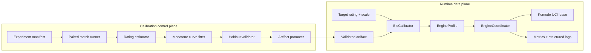
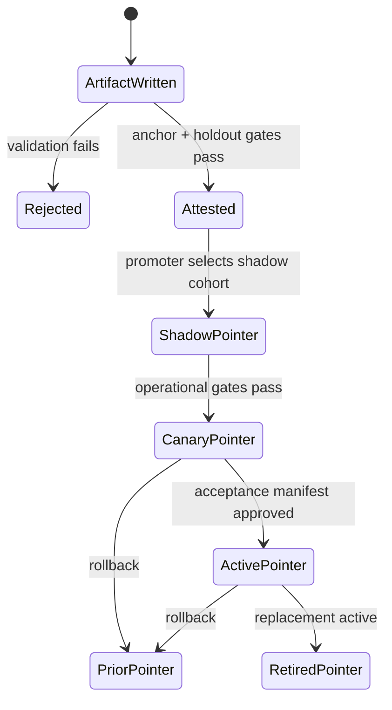

# Architecture Spine — Deterministic Elo Calibration v2.0

## Design Paradigm

**Offline Control Plane, Pure Runtime Data Plane.** Tournament, estimation, fitting, and promotion produce immutable calibration artifacts offline. The online core validates one artifact and deterministically maps a target rating to an engine profile. Engine process mutation, metrics, logs, and files remain adapters.



## Inherited Invariants

| Inherited | From parent | Binds here |
| --- | --- | --- |
| AD-1 | Smart Pacing | Calibration and selection policy remain a pure core. |
| AD-2, AD-5 | Smart Pacing | Calibrated selection participates in the atomic move-plan and remains distinct from reference analysis. |
| AD-12, AD-13, AD-17 | Smart Pacing | Every behavioral boundary and promoted parameter set is versioned and distribution-validated. |
| AD-15 | Smart Pacing | Selection identity includes rating, selector version, and seed-policy version. |
| AD-16 | Smart Pacing | Callers cannot supply arbitrary UCI options; engine routes remain authenticated. |
| AD-18 | Smart Pacing | Puzzle mode cannot read or mutate competitive calibration state. |
| AD-19 | Smart Pacing | Only EngineCoordinator may own or invoke a Komodo process. |

## Invariants & Rules

### AD-1 — Offline fitting, immutable runtime [ADOPTED]

- **Binds:** calibration-artifact, runtime-calibrator
- **Prevents:** request-time learning, hidden state, and non-reproducible rating changes.
- **Rule:** Match execution, rating estimation, curve fitting, validation, and promotion occur offline. Runtime accepts only a schema-valid immutable artifact and performs a pure lookup plus deterministic resolution.

### AD-2 — Elo always names a scale [ADOPTED]

- **Binds:** elo-scale, API, benchmark-pipeline
- **Prevents:** treating Chess.com, Lichess, FIDE, CCRL, and engine-local Elo as interchangeable.
- **Rule:** Every target and artifact carries `scaleId`, protocol version, reference pool, time control, and supported range. Bare ratings are invalid at the core boundary.

### AD-3 — Strength and search budget are orthogonal [ADOPTED]

- **Binds:** uci-profile, search-policy
- **Prevents:** the existing nonlinear interaction among Skill, Depth, Nodes, hardware, and position.
- **Rule:** Target Elo never changes `depth` or `nodes`. Each curve is keyed by an artifact-backed `budgetClass`; engine binary, Threads, Hash, selector MultiPV, time-control policy, search-state reset policy, concurrency, opening policy, and tablebases are fingerprinted within that class. Any change creates a new class/artifact and requires validation.

### AD-4 — Monotone empirical interpolation [ADOPTED]

- **Binds:** interpolation, uci-profile
- **Prevents:** arbitrary linear mappings, global-polynomial overshoot, and illegal fractional Komodo options.
- **Rule:** Weighted isotonic regression fits canonical anchors `rating = R(skill)` for every integral Skill. PCHIP is evaluated only in that forward direction with strictly increasing Skill as its axis. Runtime uses the left-continuous generalized inverse `inf{s | R(s) >= target}`; an exact plateau rating resolves to its lowest Skill. The artifact stores anchors, forward coefficients, inverse convention, and numeric-serialization version. For fractional latent Skill, one Skill is resolved and pinned per game from SHA-256 over a canonical length-prefixed UTF-8 tuple `(seedPolicyVersion, artifactChecksum, runtimeGameToken, targetElo, side)`: the first unsigned 64-bit big-endian word divided by `2^64` selects the upper adjacent Skill when below the fractional weight. Fractional policies require holdout validation.

### AD-5 — No extrapolation beyond measured support [ADOPTED]

- **Binds:** elo-scale, errors, fallback
- **Prevents:** fabricated support for 800–1200 or ratings above full strength.
- **Rule:** Targets outside validated bounds are rejected or returned as an explicitly typed degraded/clamped result according to caller policy. Runtime never extrapolates beyond measured Skill 0 and Skill 25 anchors.

### AD-6 — Below-floor ratings are unsupported in v2.0 [ADOPTED]

- **Binds:** low-elo, errors, human-likeness
- **Prevents:** shipping an underspecified candidate selector or using shallow search to imitate 800–1200 play.
- **Rule:** v2.0 rejects targets below the measured Skill-0 floor. A future `LowEloSelector` is a separate architecture/artifact family with its own candidate source, fixed engine profile, seed/cache identity, tactical-safety policy, match-Elo gate, human-move-likeness gate, and licensed dataset; it cannot modify or masquerade as the Skill-only curve.

### AD-7 — Statistical proof uses paired outcomes [ADOPTED]

- **Binds:** benchmark-pipeline, promotion
- **Prevents:** accepting anecdotal win rates, color/opening bias, or incomplete games as calibration evidence.
- **Rule:** Each experiment uses color-reversed opening pairs from an immutable manifest. Engine A is always the calibrated subject; the canonical vector is `[LL, LD, DD_or_WL, WD, WW]` from A's two-game score, with reversed mixed outcomes normalized by score. Only pairs whose two games have terminal classified results enter the estimator; crash, illegal-move, adjudication, and time-forfeit pairs remain separately counted and fail operational gates. Promotion uses the versioned pentanomial likelihood/confidence implementation named in the manifest, passes predeclared equivalence bounds on anchor and independently hash-split holdout targets, and records sufficient statistics and tool versions.

### AD-8 — Stage profiles apply atomically under one move-plan lease [ADOPTED]

- **Binds:** EngineCoordinator, move-plan, stage-profiles
- **Prevents:** process-global UCI option races, weakened reference evidence, and mutation during search.
- **Rule:** EngineCoordinator holds one exclusive request/job lease for the inherited `reference-shallow → selector → reference-deep` transaction. It may transition only while the engine is idle: canonical reference profile, calibrated selector profile, then the identical reference profile. Before every stage it issues the configured `Clear Hash`, waits for `isready`, and therefore forbids transposition-table inheritance across stages; calibration matches issue the same reset before every selector move. “Verified” means adapter desired/applied-state equality for the current process generation followed by successful `isready`; UCI read-back is not assumed. Any uncertain apply/reset/restore state restarts the process, invalidates the generation, and returns the inherited typed selector fallback. Profile-application/reset time consumes the absolute move-plan deadline.

### AD-9 — Metrics aggregate; bounded slots expose active state [ADOPTED]

- **Binds:** observability, telemetry
- **Prevents:** high-cardinality Prometheus failures and untraceable rating decisions.
- **Rule:** Prometheus exposes completed target Elo and applied Skill distributions as fixed-bucket histograms. Current target, Skill, and active status are gauges only per configured bounded engine-slot label and are cleared when the lease ends. Nodes and search-seconds counters include the same completed search population so their rate ratio is meaningful. Stable labels are allowlisted (`slot`, `stage`, `status`, `scaleId`); game IDs, FENs, user IDs, seeds, target values, and artifact checksums never become labels. Metrics bind loopback only behind the existing bearer boundary or a separately configured loopback scrape listener.

### AD-10 — Immutable artifacts and mutable activation are separate [ADOPTED]

- **Binds:** deployment, rollback, operations
- **Prevents:** unvalidated configuration pushes and irreversible calibration regressions.
- **Rule:** A content-addressed `CalibrationArtifact` is immutable. An immutable `ValidationAttestation` binds its checksum to manifest, holdout report, thresholds, owner/approver role, and result. The calibration promoter is the sole writer of a mutable `ActivationRecord`, published by atomic same-volume replacement; runtime is read-only and loads only a fully verified artifact-attestation pair. Rollback repoints to a prior attested checksum and never edits artifact bytes. `(cohort, artifactChecksum, scaleId, seedPolicyVersion)` is pinned to `runtimeGameToken` at the first calibrated move; activation affects new games only unless emergency policy explicitly degrades existing sessions.

### AD-11 — Experiment records are canonical and idempotent [ADOPTED]

- **Binds:** benchmark-pipeline, estimation, sharding
- **Prevents:** two tools producing different curves from the same games.
- **Rule:** The manifest versions canonical game/pair IDs, subject/opponent perspective, result enum, exclusion rules, pentanomial order, estimator, confidence method, isotonic weights, PCHIP/generalized-inverse convention, decimal precision, holdout split, and tool versions. One pair has one idempotency key; resume/sharding may append only a missing complete pair. A checked-in miniature corpus must reproduce byte-identical sufficient statistics, artifact coefficients, inversions, and gate decision.

### AD-12 — Calibration identity extends every move-affecting key [ADOPTED]

- **Binds:** move-plan DTO, selection-cache, contextual-plan-cache
- **Prevents:** cached moves crossing scales, artifacts, games, or resolved Skills.
- **Rule:** The server maps the existing `moveSelectionElo` plus configured/default `scaleId` into a versioned calibration request; clients never provide UCI options. The plan response includes `scaleId`, artifact checksum/version, `budgetClass`, latent Skill, applied Skill, resolver version, profile digest, calibration status, and reason. Selection and complete-plan identities extend inherited AD-15 with `scaleId`, artifact checksum, resolver version, stable per-game resolution key, applied Skill, and `budgetClass`; activation invalidates incompatible cache entries. Old clients use an explicitly configured default scale during the compatibility window or fail closed when none exists.

### AD-13 — Clock safety outranks calibration claims [ADOPTED]

- **Binds:** live deadlines, budget-class, fallback
- **Prevents:** silently truncating a calibrated selector and still reporting its target Elo.
- **Rule:** A selector may start only when the inherited absolute deadline can satisfy an artifact-backed budget class's minimum admission budget, including stage-profile transitions. Otherwise it is not started, returns the inherited typed fallback, and reports `calibrationStatus=not_applied`. Variable live budgets select only among validated budget classes; no request invents a smaller time/depth/node limit.

## Consistency Conventions

| Concern | Convention |
| --- | --- |
| Ratings | Integer `targetElo` plus mandatory stable `scaleId`; estimated differences and intervals are floats. |
| UCI | Komodo `Skill` is an integer in `[0,25]`; callers never provide arbitrary option names. |
| Randomness | SHA-256-derived, versioned seed from artifact, game identity, color, and policy scope; every choice is replayable. |
| Time | Seconds in benchmark manifests and Prometheus base units; integer milliseconds at existing Smart Pacing API boundaries. |
| Artifacts | Canonical JSON, explicit `schemaVersion`, append-only experiment outputs, SHA-256 checksum. |
| Errors | Typed unsupported-range, artifact-invalid, engine-mismatch, profile-apply, benchmark-incomplete, and degraded-mode outcomes. |
| Logging | Structured fields include scale, target, curve version, latent/applied Skill, seed policy, search policy, clamp, engine hash, nodes, elapsed, and NPS. |
| Metrics | Prefix `thinker_engine_`; labels are bounded enumerations only. |
| Engine options | Canonical allowlisted profile digest; desired/applied state is scoped to process generation and confirmed with `isready`, never UCI read-back. |

## Stack

| Name | Version |
| --- | --- |
| Python | 3.12 |
| chess package | 1.11.2 |
| Komodo | 14.1 64-bit |
| prometheus-client | 0.26.0 |
| SciPy | 1.18.1, offline only |

## Structural Seed

```text
core/
  elo_calibration/
    models.py
    artifact.py
    activation.py
    interpolation.py
    calibrator.py
    telemetry.py
    errors.py
tools/
  elo_calibration/
    run_matches.py
    estimate.py
    fit_curve.py
    validate.py
    promote.py
tests/
  elo_calibration/
    test_interpolation.py
    test_artifact.py
    test_determinism.py
    test_coordinator_contract.py
    test_statistics.py
```



## Capability → Architecture Map

| Capability / Area | Lives in | Governed by |
| --- | --- | --- |
| Target-to-profile mapping | `core/elo_calibration/calibrator.py` | AD-1, AD-2, AD-4, AD-5 |
| Artifact validation | `artifact.py` | AD-1, AD-3, AD-10 |
| Deterministic resolution | `interpolation.py` | AD-4, randomness convention |
| Engine application | existing `EngineCoordinator` adapter | inherited AD-19, local AD-8 |
| Paired tournaments | `tools/elo_calibration/run_matches.py` | AD-3, AD-7 |
| Estimation and fitting | `estimate.py`, `fit_curve.py` | AD-4, AD-7 |
| Holdout and promotion | `validate.py` | AD-7, AD-10 |
| Runtime observability | `telemetry.py` | AD-9 |
| Live budget admission | existing coordinator/deadline registry | AD-3, AD-13 |
| Calibration API/cache identity | move-plan contracts and caches | AD-12 |
| Human-like low ratings | unsupported in v2.0; future `LowEloSelector` | AD-5, AD-6 |

## Deferred

- **Product rating namespace:** choose the initial `scaleId` and whether a later bridge to Chess.com ratings is required before the first experiment manifest is approved.
- **Acceptance thresholds:** the proposed ±35 Elo point and ±75 Elo 95% interval after at least 200 pairs remain `[ASSUMPTION]` until pilot variance and draw rate support power analysis.
- **Skill-0 floor:** measurement decides whether the low-Elo policy is required; architecture forbids guessing.
- **Human-game dataset and licensing:** required before a separate low-Elo architecture may be adopted.
- **Distributed benchmark execution:** introduce only after one-host throughput is measured; shard ownership must preserve complete opening pairs.
- **Benchmark retention:** before the first large run, define immutable run directories, disk preflight budget, retention duration, and safe pruning that never removes data referenced by an attestation.
- **Fastchess adoption:** optional until a pinned release/binary hash passes the same miniature-corpus and Windows process-recovery contracts as the Python runner.
