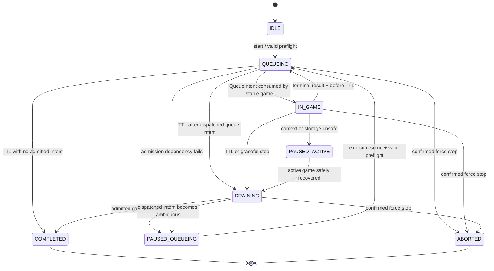

# Architecture Spine — Module 14

## Design Paradigm

**Single-Writer Event-Sourced Session Controller.** A pure reducer owns session lifecycle, win-rate state, and DDA decisions. IndexedDB is the transactional authority for mutable session data. GM storage contains durable user configuration and a recovery pointer, never concurrent truth. Browser tabs, DOM discovery, clocks, storage, and `/move-plan` are adapters around the reducer.

```mermaid
flowchart LR
    UI[Admin UI] --> CMD[Session commands]
    DOM[Chess platform adapter] --> EVT[Canonical events]
    CLK[Wall-clock adapter] --> EVT
    EVT --> RED[Pure session reducer]
    CMD --> RED
    RED --> TX[IndexedDB transaction]
    TX --> SNAP[Session snapshot]
    TX --> JOURNAL[Idempotent event journal]
    LEASE[Leader lease + fencing] --> TX
    SNAP --> GATE[Automation gate]
    GATE --> AQ[Existing Auto Queue adapter]
    GATE --> AM[Existing single Auto Move scheduler]
    SNAP --> MPC[/move-plan client]
    MPC --> API[Authenticated Flask API]
    CFG[GM configuration port] --> RED
```

## Inherited Invariants

| Inherited | From parent | Binds here |
| --- | --- | --- |
| AD-1, AD-3 | Smart Pacing | Session/DDA decisions remain pure; browser owns live session context while backend owns chess analysis. |
| AD-8 | Smart Pacing | The existing single scheduler remains the only move executor and must revalidate current identity before moving. |
| AD-10, AD-11, AD-12 | Smart Pacing | Pacing correctness remains reconstructible; durable settings use ports; every behavioral boundary is versioned. |
| AD-15 | Smart Pacing | Observation, analysis, game, and session identities remain distinct. |
| AD-16, AD-18, AD-19 | Smart Pacing | Bearer boundary remains mandatory; Puzzle cannot mutate competitive state; EngineCoordinator remains sole engine owner. |
| AD-2, AD-5 | Elo Calibration | Every target names a scale and cannot extrapolate outside validated support. |
| AD-10, AD-12, AD-13 | Elo Calibration | Calibration/profile is pinned per game, participates in move identity, and never outranks clock safety. |

## Invariants & Rules

### AD-1 — Exactly one fenced automation writer

- **Binds:** browser-tabs, auto-queue, auto-move, result-ingestion, persistence
- **Prevents:** duplicate queue clicks, duplicate result counts, stale-tab moves, and split-brain DDA decisions.
- **Rule:** Module 14 runs only on the canonical top-level origin `https://www.chess.com` with `@noframes`; other matched origins expose no automation and navigate/ask the user to use the canonical host. One origin-scoped Web Lock serializes lease acquisition/takeover and every irreversible browser effect. Inside that lock, one IndexedDB lease elects the writer; acquisition/takeover increments a monotonic fencing token while renewal preserves it. Every mutation binds `(authorityEpoch, sessionId, ownerTabId, fencingToken)`. Immediately before synchronous DOM dispatch, the holder revalidates the unexpired lease in IndexedDB without releasing the Web Lock. `BroadcastChannel` and GM listeners are notifications only. Absence of Web Locks or IndexedDB blocks session start.

### AD-2 — Absolute TTL, graceful drain [ASSUMPTION]

- **Binds:** lifecycle-timer, auto-queue-admission, active-game
- **Prevents:** Chrome timer throttling from extending a session or TTL expiry from abandoning an admitted game.
- **Rule:** Start persists `startedAtEpochMs` and `deadlineEpochMs`; `setTimeout` is only a wake-up hint. Lease and lifecycle comparisons use `effectiveNowMs=max(Date.now(), lastObservedEpochMs)`. A queue intent requires `effectiveNowMs + minimumAdmissionHeadroomMs < deadlineEpochMs`. On first entry to `DRAINING`, atomically persist `enteredDrainingAtEpochMs=effectiveNowMs` and `drainDeadlineEpochMs=effectiveNowMs+maximumDrainMs`; these values never extend. An already dispatched queue intent or active game drains only until that deadline; no later queue effect is permitted. At the deadline automation stops without fabricating an outcome and the session enters terminal `ABORTED` with `completionReason=UNRECONCILED_DRAIN_TIMEOUT` for manual handling.

### AD-3 — DDA is per-game, never per-move

- **Binds:** dda-actuator, active-game, move-plan-client, calibration-pinning
- **Prevents:** engine strength changing mid-game, reload changing the target, and calibration-cache identity drift.
- **Rule:** After a stable game/opponent observation and before the first plan request, one transaction snapshots `controllerMode`, opponent rating evidence, offset, raw target, effective target, scale, artifact capability, `runtimeGameToken`, and initial position identity. Every move in that game uses the same effective target. Only a terminal idempotent result may update the controller for the next game.

### AD-4 — True two-threshold hysteresis [ADOPTED]

- **Binds:** win-rate-loop, controller-mode, actuator
- **Prevents:** `+200/-200` oscillation around one threshold and contradictory interpretations of “inside the band.”
- **Rule:** The controller starts in `BOOST`. After the sample gate, `BOOST → CORRECT` only when the versioned posterior win-rate estimate is strictly greater than `maxWinRate`; `CORRECT → BOOST` only when it is strictly less than `minWinRate`. Values inside `[min,max]` retain the current mode. `BOOST` resolves `+200`; `CORRECT` resolves `-200`. Equal-to-boundary values do not transition.

### AD-5 — Statistics are deterministic and auditable [ASSUMPTION]

- **Binds:** outcome-ledger, win-rate-estimator, observability
- **Prevents:** small-sample extremes, draw ambiguity, duplicate outcomes, and retroactive controller changes.
- **Rule:** Keep separate `observedCounts` for every unique W/D/L session result and `controlCounts` for controller-eligible games. Controller version `beta-binomial-terminal-v1` uses `posteriorMean=(controlWins+1)/(controlTerminalGames+2)` after `minCompletedGames`; W/D/L increment the relevant terminal count and only W increments wins. A deterministic Wilson 95% interval is presentation telemetry only. A game is controller-eligible only if at least one engine-sourced plan was applied and every engine-sourced response matched the complete pinned calibration identity; book/forced responses are neutral, while any fallback/shadow/mismatch irreversibly invalidates control eligibility. Every observed result is immutable and unique by `(sessionId, canonicalPlatformGameId)`.

### AD-6 — IndexedDB is authority; GM storage is recovery/configuration [ASSUMPTION]

- **Binds:** persistence, reload-recovery, settings, migration
- **Prevents:** non-atomic `GM_setValue` updates, localStorage loss, and two stores becoming competing sources of truth.
- **Rule:** Versioned IndexedDB transactions atomically append the event and replace the session snapshot. GM storage contains validated configuration plus a compact recovery pointer written only after the IndexedDB commit. On disagreement, IndexedDB wins. If IndexedDB is unavailable/corrupt or only a GM recovery pointer survives, the controller enters `PAUSED_QUEUEING` or `PAUSED_ACTIVE` with `pauseReason=STORAGE_UNAVAILABLE` and admits no new game until explicit recovery/reset; it never guesses counters or creates a replacement session silently. Page `localStorage` is not used by Module 14.

### AD-7 — External effects use durable claims, never blind replay [ASSUMPTION]

- **Binds:** platform-adapter, auto-queue, outcome-ledger
- **Prevents:** F5 between observation and commit, URL-change double counting, and a queue click just before TTL becoming an unowned game.
- **Rule:** A queue effect progresses `PREPARED → CLAIMED → DISPATCHED → MATCH_OBSERVED`; cancellation before claim becomes `CANCELLED`. `CLAIMED`/`DISPATCHED` surviving owner loss or timeout becomes `AMBIGUOUS` and is never automatically clicked again. No new queue may occur until the platform positively reports cancellation/idle twice at least 250 ms apart and a 30-second quarantine elapses. Any game appearing meanwhile consumes the old intent and is drained. Claim and dispatch occur under the AD-1 Web Lock; dispatch is synchronous after fence validation. An observed canonical game consumes the intent and becomes `ActiveGame`. A terminal result is accepted only for that active game and commits once under `result:<canonicalPlatformGameId>`.

### AD-8 — DDA changes selection strength only [ADOPTED]

- **Binds:** move-plan-contract, Smart-Pacing evidence, EloCalibrator
- **Prevents:** lowering playing strength from also changing perceived complexity and timing behavior.
- **Rule:** Module 14 supplies `activeGame.effectiveTargetElo` as `moveSelectionElo`. `perceptionElo` remains the independently configured session/player perception value. The client sends no Skill, Depth, Nodes, Hash, MultiPV, or other UCI option. The backend remains the sole mapper from target Elo to the pinned calibrated profile.

### AD-9 — Calibration support is a pinned backend contract [ASSUMPTION]

- **Binds:** actuator-capability, target-range, degraded-mode
- **Prevents:** extrapolated ratings, shadow-mode results being treated as actuated, and fallback moves contaminating DDA evidence.
- **Rule:** Chess.com ratings name a time-control-specific platform scale and are never assumed numerically equal to the Stockfish-UCI calibration scale. A validated content-addressed cross-scale artifact maps `opponentRating+offset` into target Elo. Before queue admission, authenticated `/calibration-readiness` verifies that active mapping/Elo artifacts exist for the intended platform scale without pretending an opponent or target is known. After a game and opponent are stably observed but before the first move plan, authenticated `/calibration-capability` accepts the preallocated `runtimeGameToken`, both scales, opponent rating, and offset, then atomically translates the target and pins mapping, rollout cohort, Elo artifact, seed policy, rollout version, and budget class. `/move-plan` schema v2 carries that exact pre-request identity; mismatch fails before engine admission. The first applied engine response additionally pins target-dependent resolver version, resolution key, latent/applied Skill, profile digest, and actual budget class; every later engine response must match all fields.

### AD-10 — Unsafe uncertainty fails closed at admission

- **Binds:** opponent-rating, storage-health, leader-health, calibration-health, network-health
- **Prevents:** silently using a stale/opponent-self rating, continuing without persistence, or launching games the controller cannot own.
- **Rule:** Auto Queue requires a valid fence, writable IndexedDB, TTL headroom, no unresolved intent, fresh active calibration readiness for the intended platform scale, and eligible account/test context. After match observation, Auto Move remains blocked until the game-specific calibration capability is pinned. It additionally requires a writable authority store on every durable observation revision. Storage loss stops automation even during a game and yields `PAUSED_ACTIVE` with `pauseReason=STORAGE_UNAVAILABLE`; the user may continue manually.

### AD-11 — Existing controls become inputs, not competing owners

- **Binds:** Auto Queue, Auto Move, legacy AutoAdjustRating, settings UI
- **Prevents:** the legacy rating heuristic overriding DDA and UI toggles bypassing session lifecycle.
- **Rule:** Effective gates are `effectiveAutoQueue=userAutoQueue && leader && session.canQueue` and `effectiveAutoMove=userAutoMove && leader && session.canMoveCurrentGame`. While Module 14 is running, it exclusively owns `moveSelectionElo`; legacy `AutoAdjustRating` is suspended and cannot mutate it. Stopping/completing the session releases ownership without changing the user's underlying Auto Queue/Auto Move preferences.

### AD-12 — Competitive state is account-, mode-, and session-scoped

- **Binds:** identity, Puzzle isolation, account switching, cleanup
- **Prevents:** results crossing accounts, Puzzle contaminating win rate, and an old session resuming for another user.
- **Rule:** A session binds `accountKey=SHA-256("chess.com:" + authenticatedUsername.normalize("NFKC").toLowerCase())`; the username is ASCII-validated and must agree across the canonical authenticated account-link href and board-side identity in two observations at least 250 ms apart. `canonicalPlatformGameId` uses the platform game UUID when available, else normalized immutable URL ID; provisional IDs may alias to one canonical ID in a single transaction and cannot be counted. Opponent identity/rating must belong to the opposite side of that same game and agree twice at least 250 ms apart. Terminal evidence must bind that game/account/side and agree across two observations or one explicitly supported authoritative platform response. Account mismatch or missing canonical identity pauses. Puzzle pages cannot acquire or mutate state. Completed sessions are immutable.

### AD-13 — Functional core is environment-agnostic; activation policy is an edge adapter [ASSUMPTION]

- **Binds:** session-core, session-start, platform-adapter, environment-safety
- **Prevents:** coupling deterministic lifecycle/DDA logic to third-party pool names.
- **Rule:** The functional core never imports, recognizes, or branches on Chess.com game-type, pool, rated, or live-game labels. It consumes only a typed `authorizationDecision` issued by a replaceable activation-policy port. The policy evaluator is a data-driven exact-match component: it contains no platform context or pool literals, reads a strict versioned DTO from GM storage, and compares normalized observed tokens with configured arrays using exact membership only. Empty lists deny; regex syntax, wildcards, and pattern matching are invalid. Exact membership is the complete decision: when the observed account, context, and pool strings match the configured arrays, activation is permitted regardless of whether the environment is public, private, or rated. Core unit tests use opaque context fixtures so the reducer remains portable to any other environment.

### AD-14 — Source modules have one reproducible userscript artifact

- **Binds:** frontend-source, deployment, testing
- **Prevents:** tested modules diverging from the monolithic `script.js` installed by Tampermonkey.
- **Rule:** Module 14 source lives under `frontend/session_control/`; a deterministic checked-in build script emits a delimited generated region into `script.js`, preserving the existing userscript header/vendor assets. CI rebuilds and requires a zero diff. `script.js` remains the installable artifact; generated code is never edited directly.

## Consistency Conventions

| Concern | Convention |
| --- | --- |
| IDs | 128-bit cryptographic lowercase hex for session/tab/runtime tokens; canonical platform game ID per AD-12. |
| Time | Integer Unix epoch milliseconds with `EpochMs`; in-tab elapsed diagnostics may use `performance.now()` but never durable TTL. |
| Rates | Finite decimals in `[0,1]`; UI percentages are presentation only. |
| Elo | Integer `moveSelectionElo`, explicit `scaleId`; offset and clamp are persisted separately. |
| JSON | `camelCase`, strict `schemaVersion`, unknown fields rejected at reducer/storage boundaries. |
| Persistence | IndexedDB transaction first, GM recovery pointer second; never dual-write both as authorities. |
| Mutation | Pure reducer proposes state/effects; one fenced transaction commits; adapters execute effects afterward. |
| Errors | Stable reason codes such as `TTL_EXPIRED`, `LEADER_LOST`, `STORAGE_UNAVAILABLE`, `OPPONENT_UNCERTAIN`, `CALIBRATION_NOT_ACTIVE`. |
| Logging | No bearer token, FEN, username, or raw game record in default logs; session IDs are local diagnostics, not Prometheus labels. |

## Stack

| Name | Version |
| --- | --- |
| JavaScript userscript runtime | Existing project target |
| Tampermonkey GM storage API | Existing project integration |
| IndexedDB | Browser-native |
| BroadcastChannel | Browser-native, notification only |
| Python / Flask backend | 3.12 / existing project |
| `/move-plan` contract | Existing schema v1 plus Module 14 schema v2 |

## Structural Seed

```text
frontend/session_control/
  models.js          # strict DTO validation and migrations
  reducer.js         # pure lifecycle + DDA transitions
  statistics.js      # beta-binomial-terminal-v1
  repository.js      # IndexedDB transactions and event uniqueness
  leader.js          # lease, fencing, heartbeat, takeover
  clock.js           # absolute TTL reconciliation
  controller.js      # effect orchestration
  ports.js           # GM config, platform, move-plan, telemetry interfaces
  platform-chesscom.js
  ui.js
tests/session_control/
  reducer.test.js
  statistics.test.js
  repository.test.js
  leader.test.js
  recovery.test.js
  integration.test.js
scripts/
  build_userscript.py # deterministic source-to-script.js assembly
```



## Capability → Architecture Map

| Capability / Area | Lives in | Governed by |
| --- | --- | --- |
| Session TTL and graceful stop | `clock.js`, `reducer.js` | AD-2 |
| Cross-tab ownership | `leader.js`, `repository.js` | AD-1 |
| Durable recovery | `repository.js`, GM settings adapter | AD-6, AD-7 |
| Win-rate controller | `statistics.js`, `reducer.js` | AD-4, AD-5 |
| Target Elo resolution | `reducer.js`, capability port | AD-3, AD-8, AD-9 |
| Auto Queue/Move integration | `controller.js`, existing adapters | AD-7, AD-10, AD-11 |
| `/move-plan` integration | existing Smart Pacing client | AD-3, AD-8, AD-9 |
| Competitive/Puzzle isolation | platform adapter | AD-12 |
| External authorization decision | platform adapter + config | AD-13 |
| Reproducible userscript delivery | build script + CI | AD-14 |

## Deferred

- Cloud synchronization and remote control: local single-browser-profile ownership is sufficient for v1; cross-device consensus needs a separate authority model.
- Adaptive offset magnitude: v1 uses the configured two-level actuator. PID/MPC, learned policies, or more than two offsets require offline simulation and a new controller version.
- Exposure of Bayesian prior and minimum sample in the normal UI: retain as validated admin configuration until usability requirements exist.
- Long-term session history/export: completed snapshot retention is operational tooling, not runtime correctness; define retention before enabling export.
- Platform-specific authoritative result API reconciliation: add when a stable permitted integration is selected; v1 still requires a stable platform game identity and terminal evidence adapter.
