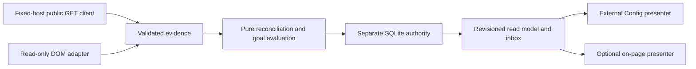

# Architecture Spine — Rating Goal Tracker

## Design Paradigm

Passive event-driven pipeline. Backend owns durable evidence and derived state; browser observes and presents. Pure domain functions decide verification and goals. The engineering plan owns the versioned contract seed and executable acceptance scenarios for the future implementation.

## Invariants & Rules

### AD-1 — Passive isolation [ADOPTED]

- **Binds:** All tracker modules and effects.
- **Prevents:** A monitoring threshold being used to control ranked outcomes.
- **Rule:** No dependency on engine, difficulty, Auto Play or matchmaking controllers; no game-control effects. Operates when all automation is disabled. External requests are documented PubAPI GETs only. Local writes change tracker evidence/settings, not gameplay.

### AD-2 — Single durable authority

- **Binds:** Persistence, UI, background work and ingestion.
- **Prevents:** Split-brain browser/server goals and repeated logical notifications.
- **Rule:** Separate backend SQLite database is authoritative. Transactions bind evidence, current snapshot, progress and outbox. Identity/game/digest/notification uniqueness and revision-CAS are enforced by storage. Single application process initially; multiple workers require durable job claims first. Existing Session Control DB and users.db remain untouched.

### AD-3 — Identity and category are mandatory

- **Binds:** Every observation, game, change, goal and cache key.
- **Prevents:** Opponent/user, mode, variant and renamed-account confusion.
- **Rule:** Use PlayerIdentityV1 and full standard-chess category as specified in ENGINEERING-PLAN sections 3/5. Board position, hidden text and queue choice are not identity/category evidence. Stable player ID controls verified alias merging; promotion and game alias resolution are atomic repository operations, with goal collisions unresolved rather than overwritten.

### AD-4 — Chronology and verification are separate from fetch recency

- **Binds:** Reconciler and source adapters.
- **Prevents:** Older cached responses replacing confirmed new state or false confirmation from repeated DOM reads.
- **Rule:** Canonical evidence hashing, immutable payload/derived-classification separation and revalidation identity follow ENGINEERING-PLAN section 3. Advance confirmed state only through effective chronology and section 5's exact public-conflict predicate. DOM stays provisional, never vetoing valid public evidence. 304 creates no rating event. Later current confirmation does not silently repair contested history. Same-second order is not guessed. Last confirmed state survives failures; missing is null, never zero.

### AD-5 — Attributed deltas only

- **Binds:** History, volatility and goal evaluation.
- **Prevents:** Fabricated per-game changes or losses being interpreted as instructions.
- **Rule:** Single-game deltas require adjacent confirmed anchors and complete category-specific rated-game sequence. Otherwise label interval or unattributed changes, or leave null. W/D/L cannot predict delta. Only confirmed eligible evidence can complete a goal. Thresholds are passive comparisons, not gameplay targets.

### AD-6 — Versioned deterministic goal state

- **Binds:** Contracts, evaluators and notification consumers.
- **Prevents:** Different definitions of progress, completion and correction across presenters.
- **Rule:** ENGINEERING-PLAN sections 3/7 define V1 contracts/formulas, baseline eligibility by validation time, monitoring/pause/edit transitions and durable proximity cycles. Immutable baseline after confirmation; achievement never predates goal creation; one active goal/category. Threshold edits create a new baseline revision. Completion is one durable historical event; contested corrections are explicit. Both near/reached notification keys and claim/ack leases follow sections 7/8, not presenter heuristics.

### AD-7 — Bounded acquisition and recovery

- **Binds:** HTTP client, coordinator, jobs and diagnostics.
- **Prevents:** Request storms, permanent stale state and cross-origin proxy abuse.
- **Rule:** Serial fixed-host GET queue, single-flight resources, HTTP validators, server-respected cache/cooldown and durable jobs. Identity changes invalidate generations. No cache-busting or private endpoints. Strict local origin/Host/JSON validation; no wildcard tracker CORS. One failing source does not erase other observations. Notification event uniqueness does not claim exactly-once visual delivery.

### AD-8 — Read-model-only presentation

- **Binds:** Both presenters and Clean View.
- **Prevents:** UI recomputing truth or hiding uncertainty.
- **Rule:** Present separate confirmed, provisional, stale, conflict and unavailable values from RatingViewV1. All text en-US. Clean View suppresses on-page visuals only. No request to change rating visibility. No guaranteed games-to-go predictions. Proposed proximity and retention settings are the explicit policies in the engineering plan, not hardcoded provider guarantees.

## Consistency Conventions

| Concern | Convention |
| --- | --- |
| Contracts | Versioned Python validation + shared JSON Schema; JSDoc frontend; fixture parity gate. |
| Time | UTC integer epoch milliseconds; provider seconds converted at ingress. |
| Identity | Stable provider ID namespace when available; canonical username aliases verified before merge. |
| Game keys | Platform + live/daily/unknown namespace + ID; alias resolution never silently merges unknown pools. |
| Errors | Structured bounded code, source, retryability, retry time and correlation ID; preserve confirmed state. |
| Telemetry | Dedicated allowlist, no tokens/raw DOM, no normal continuous console logging. |

## Structural Seed

`core/rating_tracker/` owns contracts/client/storage/domain/service/routes. `frontend/rating_tracker/` owns read-only browser ingress/bridge/presenter. External Config integrates the same read model through dedicated tracker routes. No new runtime package is proposed; use the repository's existing Python/Flask/SQLite and JS build tooling. Implementation paths and storage/API fields are detailed in ENGINEERING-PLAN sections 3/4/8.

## Deferred

- Authenticated selector/hidden-rating smoke, maximum archive bounds and exact Tampermonkey transport need verification in phase 0/3; failures must degrade explicitly, not relax verification rules.
- Remote multi-user deployment, browser push delivery, variants and calibrated predictions are outside this feature. No module may depend on them.
- Retention, 15-minute freshness and 20/30-point proximity are explicit proposed policies, reviewable before implementation without weakening the invariants.
